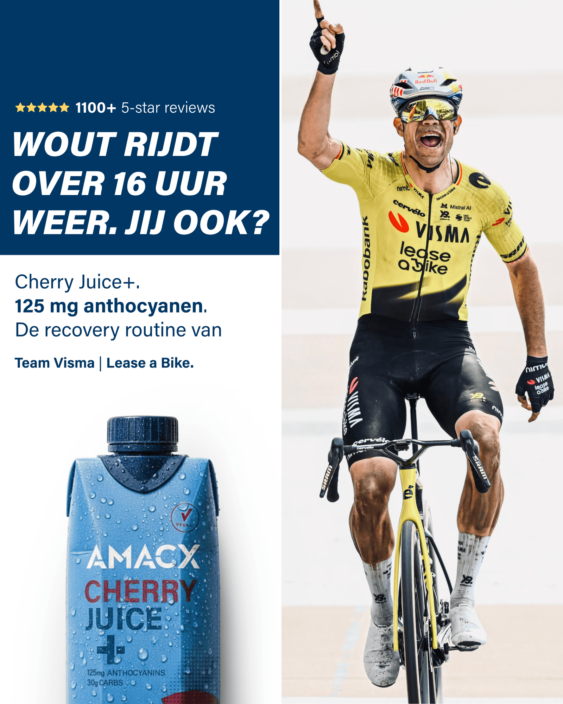
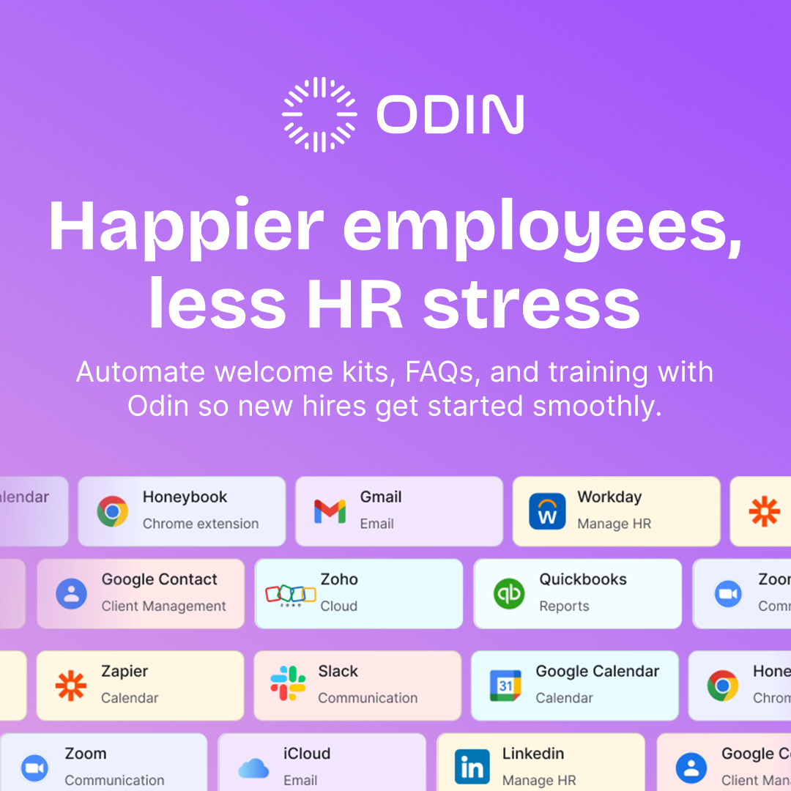
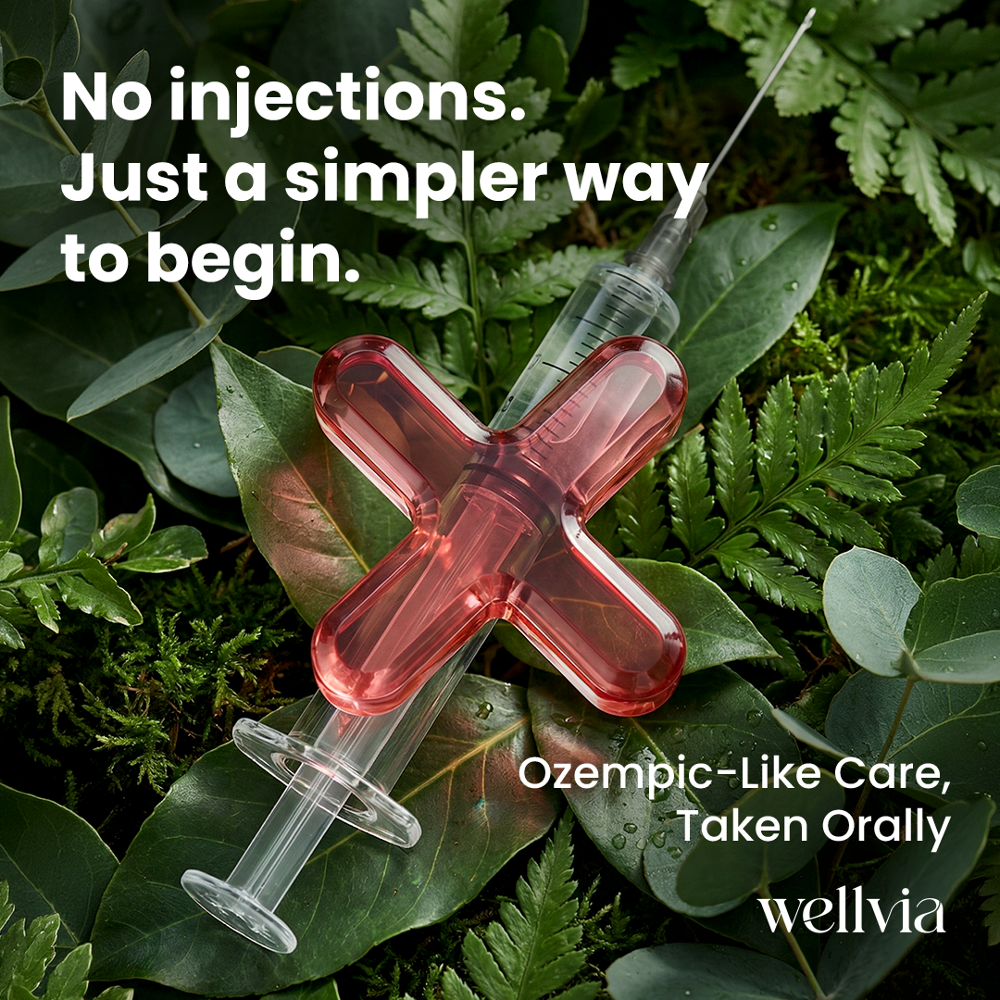

# Design Bible - Shresht

The working rules for how we design ads. Every entry is dated because styles expire. Updated daily, or whenever we talk design, whichever comes first. Started 21 November 2026.

## How this doc works

- Updated every day, or whenever we have a conversation about designs. Every new design decision lands here as a dated changelog entry. (Rule, 21 Nov 2026.)

- Every style and reference entry carries a date. An entry holds until a newer dated entry replaces it. (Rule, 21 Nov 2026.)

- Feedback is logged visually: the commented frame's screenshot plus the note, so the mistake is seen, not paraphrased. (Rule, 21 Nov 2026.)

- The changelog at the end is the running record. Newest decisions go on top.

- New design rules from Shresht land here straight away: Claude adds, commits and pushes them without asking him first. (Rule, 25 Nov 2026.)

## Standing workflow rules

- 21 Nov 2026. Before any design work starts, check three things: the brief, the existing designs, and the winning ads. Every time, before beginning.

- 21 Nov 2026. Every update about Figma work includes the specific Figma link it concerns. Updates about a specific frame include the frame link.

- 20 Nov 2026. MPS copy is verbatim. Hook, body, CTA and disclaimer go in exactly as written. If copy feels too long for the layout, flag it to Shresht and he checks with the concerned person. Never shorten or rewrite it ourselves.

- 20 Nov 2026. Batch anatomy: one Figma file per client ("Client x Rv"), one page or section per batch. Frame name = MPS Asset ID exactly, plus the ratio (9x16 or 1x1). Every concept ships as V1 and V2, each in both ratios.

- 20 Nov 2026. A design drop is reported only when the full requested set is done, not piecemeal.

- 20 Nov 2026. After anything ships, open it the way a viewer would and visually verify every image, every order, every text before calling it done.

- 22 Nov 2026. Feedback scope and editability: feedback given on one ad can apply to all ads in the batch; a change made on one ratio (e.g. 4:5) is mirrored on its resizes. Every ad ships fully editable: native text layers, native CTA shapes, separate photo and logo layers.

- 22 Nov 2026. Safe zones: the Meta safe-zone reference is the Figma Community file at figma.com/design/A3p5Z0WK0gIiv1u7bUSpwC. Place the safe-zone layer in the background of every frame while designing to check text placement; hide it when done but keep it in the layers so he can cross-check.

- 25 Nov 2026, from Shresht. No AI-tell microtype: never add eyebrow labels ("Nº 01 — Standard"), tiny tracked-caps labels, numbered callout labels or catalogue index numbers. They flag the work as machine-made. An ad carries the brief's copy, the logo, and graphic devices with no words on them. (Rejected directions, entry 6.) Round 3 adds generic UI icons: circle-badge ✓/× marks "give off a Claude vibe", so comparison marks are hand-drawn (marker strokes, slight rotation, uneven weight). (Entry 7.)

- 25 Nov 2026, from Shresht. Safe-zone margins, as numbers: on 1:1 every text layer, CTA and logo sits at least 108 px from every edge (use 112). On 9:16 copy stays between y 270 and y 1248, between x 65 and x 1015 (use a 90 px side margin), and clear of the Reels icon column (x > 885 below y 1087). Imagery and textless devices may run into the margins. This replaces the 48 px margin taken from his 23 Nov ad 01 edit.

- 23 Nov 2026, 1:43am. Full editability is a hard rule (Shresht: "every ad board makes it. It should be editable"): every ad must be fully editable in Figma, with real text layers and separate logo, product and background layers. Nothing is flattened into an image.

- 23 Nov 2026, 2:40am. One visual per ad. All four canvases of one ad (V1 1x1, V1 9x16, V2 1x1, V2 9x16) use the same visual and layout; V2 changes only the copy. Variation happens between ads, never inside one ad. Shresht: "There is to be no variation made in the visual of the second variation. The only thing that needs to be changed is the text." Build V1, clone it for V2, swap headline, body and CTA, and re-fit the type to the new copy.

- 23 Nov 2026. When Shresht edits a frame himself, diff it against the build (sizes, positions, line breaks, gaps, alignments), work out why he made each change, mirror it on the other ratio and the other version, and log the lesson here.

- 22 Nov 2026. Design-read receipt: before producing or revising any ad, print what was read - the brief, the brand rules, his latest feedback comments - with counts. Work from that receipt.

- 22 Nov 2026. Craft floor: one idea per frame, real light direction, type with an idea, designed ground (no flat default backgrounds). A frame that fails this floor does not ship to him.

- 22 Nov 2026. Blind read-back on all rendered text: transcribe every glyph from the pixels without looking at the source copy, then diff. Mismatches fail the frame.

- 23 Nov 2026. Read-back exception for font features: an old-style figure in a serif body face (a "1" that reads like a short dotless i, as in "Alpha1" set in a Goudy-style body) is the font's design, not a wrong glyph. If the client's approved earlier work sets it the same way, it stays: note it once and do not fail the frame. Switching to lining figures is Shresht's call (Figma: Type details > Numbers > Lining). Example: Alpha One batch 2 QC; the rule applies to every client and every ratio.

- 22 Nov 2026. Scale anchors: each product gets a lock entry with one verbatim real-world-size sentence, injected into every render prompt; QC measures the rendered ratio against it. Lock entries live under Client product locks and claims registers.

- 22 Nov 2026. Claims register: for each client, every factual claim used in ads becomes a row with a status (live / unverified / blocked); re-verify against the client's live site before use, and refuse non-live claims. The register for Alpha One Labs starts on the next batch.

- 22 Nov 2026. 2-pass generation budget: max 2 generative passes per ad per round; a second failure means held and reported, not more grinding. Replaced by 23 Nov 2026 (Image budget: 2 images per ad).

- 22 Nov 2026. Exact-size contract: canonical sizes enforced at export, native resolution plus proper resampling only, no upscalers. Upscaler clause replaced by 23 Nov 2026 (Image generation routing).

- 25 Nov 2026, from Shresht. Behance presentations: every Behance project is "really Behance-coded, seamless" and opens on a "really, really show-stopping, attention-grabbing aesthetic cover". Make the cover in 3 options and keep the one that wins the gallery-thumbnail test. Design from the Behance research notes (research/behance-presentations.md), never from a generic template. All Behance series (showcase ads, the monthly LinkedIn roundup) share one house system, cover language, grid and type, so the profile reads as one body of work ("make consistency in the designing"). Plan: behance/SHOWCASE-PLAN.md.
- 25 Nov 2026, Behance house system (from the step A research, 17 projects). Covers are 1616 x 1264 JPEG (no GIF covers), designed for the live 315 x 246 card: one idea, never a wall of ads; title readable at 315 px wide, at most 4 words, one focal point, and it must stand apart from the mostly dark gallery shelf. Module 1 repeats the cover bigger. Seamless means module spacing 0 and one ground colour (warm off-white #F4F1EA, plus the hero's own colour at chapter breaks, at most one dark chapter). Modules are exported 2800 px wide on a 12-column grid, 200 px outer margin. Type is General Sans (display) + Satoshi (text), matching the live banner. Each ad gets one subtitle-style caption line in the ads' voice, never "The Challenge / The Solution" labels; no eyebrows or pill tags. Show context once (a real feed view), then large flats; no tilted 3D stacks inside the scroll. Always end on a close module (principles + contact). Full system: research/behance-presentations.md section 5.

- 22 Nov 2026. Weekly rule fold: keep a dated log of his feedback; fold recurring lessons into these standing rules weekly and report the fold.

- 22 Nov 2026. Supersession: the 21 Nov 2026 rule "Instinct does not execute ad design" (Rejected directions, entry 3) no longer holds. Shresht handed batch execution back to Instinct on 21 Nov, and the pipeline rules above govern that work from here.

## Rejected directions

Each entry shows what was made, his note, and the rule it leaves behind. These are do-not-repeat records, not drafts to revive.

### 1. "image stretched", 20 Nov 2026, 10:35pm

His Figma comments on both 1x1 frames: "image stretched" / "Image is stretched". Cause: replacement photos were uploaded into template layers that kept the old image's crop transform, so the photo strips rendered warped. Fixed the same night.

Rule it left: after replacing an image in a template layer, reset the fill and reframe the crop. Never trust an inherited transform. He flags distortion instantly.

The set those comments were on, shown after the fix. The original warped state was not separately archived.

*Visual reference retained in the internal Design Bible; not included in this public copy.*

### 2. Misses the moodboard language, 20 Nov 2026, 11:50pm

His note: the designs did not match any design language or style from the moodboards and reference links he had shared.

The gap analysis that followed, recorded so the same six failures do not recur:

- Template-default composition: a cream card with a photo strip, the template's own layout.

- Headlines too timid to be the biggest event on the ad.

- The honey italic accent missing on V1.

- Flat staged photos that read generated.

- No signature graphic device; nothing that makes the ad recognisably his.

- Stacked-up density: too many elements competing.

Rules it left: no cream-card-plus-photo-strip templates. Either a full-bleed photo with type in the quiet zone, or a confident solid ground with one staged element. The headline must be the biggest thing on the ad. One signature graphic device per ad. Elements should break frame boundaries for real depth.

### 3. The rebuilt direction, rejected entirely, 21 Nov 2026, 1:44am

What was made: a full rebuild in a new file. V1 in a full-bleed photography register; V2 on a solid sand ground with a cutout figure and a honey ring as the signature device. Both in 9x16 and 1x1.

His call: the rebuild does not land either. Design execution waits for Claude; Instinct-led designing stops here.

Rule it left: Instinct does not execute ad design. The workflow rules above still govern whoever designs next.

The four rebuilt frames as delivered for review, 21 Nov 2026. Rejected as a direction.

*Visual reference retained in the internal Design Bible; not included in this public copy.*

### 4. Alpha One batch 2 ad 01 "Inspection Booth", review comments, 23 Nov 2026, 2:38-2:40am

What was made: a glass vial on the seam between a matte white and a matte black inspection panel. V1 had a black top band with white type and a red key phrase; V2 had a white top with black type and a different close-up crop. Each was built in 1x1 and 9x16 as separate editable layers.

His notes (Figma comments) and the rule each one leaves:

- "Change this text to white... The red is not matching with the background. It's not feeling like a really present-to-eye contrast." Rule: on dark or black grounds the whole headline is white.
- "The background behind the logo is a bit dark, so the logo is a bit merging in that... make that part of the background white." Rule: sample the ground behind the logo; brighten any falloff to clean white.
- "We don't want to show liquid in vials." Rule: vials are empty, or hold fine sand-like powder filling about 10% from the bottom.
- "The visuals of all four canvases of the same ad should be the same." Rule: one visual per ad; V2 changes only the text (see Standing workflow rules).
- "See the changes I did here... Take notes for the future and do the same changes on the resize 9:16 ratio." He re-laid V1 1x1 by hand; the lessons are under Layout design rules, "From his own edit".

### 5. Alpha One batch 2 ads 02 and 05, readability comments, 23 Nov 2026, 4:54am

What was made: ad 02, a glass vial in an infinity mirror of receding vial rows on black, with a white headline and a thin serif body set just above the rows; ad 05, three vials rising on stone and red plinths against a cream wall crossed by a hard window-shadow band, with the black-and-red headline and dark serif body on the left. Both frames had passed a contrast-ratio check.

His notes (Figma comments) and the rule each one leaves:

- Ad 05: "Readability issue because of the shadow behind the text and the visual." Rule: no shadow band, light streak or tonal edge runs through the ground under any text block, or behind the product. Fixed by relighting the plate locally: the shadow lifted to the lit-wall colour, the plaster grain kept, and what shows through the glass vial shifted by the same amount.
- Ad 02: "Text readability issue." Rule: thin serif body never sits on glowing or busy shapes, even on a dark ground. Fixed with an editable gradient scrim layer between the background and the product, holding the copy zone near black and fading out above the hero vial.
- Together: a contrast ratio alone does not clear a frame. Look at the ground under every text block for edges, streaks and glow, and plan the copy zone in the render itself.

### 6. Alpha One batch 2 premium redesign, review comments, 25 Nov 2026, 12:53-12:59am

What was made: a 28-frame premium rebuild of batch 2 (7 ads, V1/V2, 1:1 and 9:16). Each frame had a "Nº 0X — word" eyebrow and Goudy-italic accent words inside the Poppins headlines ("Curiosity.", "Why?"). It also had 48 px margins on 1:1, a white label card behind the logo on every ground, the full logo with its tagline, and plain vial-on-sweep visuals with tiny tracked callout labels.

His notes (14 Figma comments) and the rule each one leaves:

- Eyebrow microtype: "Never add these. It immediately flags that this design has been made by Claude... We want to show that the real designer has made it." Rule: no eyebrows, tiny tracked-caps labels, numbered callout labels or index numbers, on any ad, ever.
- Two typefaces in the headline: "playing with two fonts to emphasize one word more... that's not working. It is again flagging, as it's done by Claude... play with the weights of the font in the heading." Also: "one font and play with the weights." Rule: one family per headline, emphasis by weight (see Hierarchy).
- Line breaks: "The text breaking is not nice when there is a full stop... break them into two sentences, and this makes the text to be read even more easily. It catches attention." He hand-edited ad 03 and ad 07 as references. Rule: see Line breaks.
- Safe zones: "take care of the safe zones... You're going way far." Rule: see Standing workflow rules (safe-zone margins).
- Logo, four comments: "when the background's always in a lighter color, we don't need to add a white label behind the logo. The logo should do its job itself", and erase the "Optimize, Regenerate, Thrive" tagline under the wordmark in every ad. Rule: see Other brand rules.
- Ad 01 visual: "the visual needs to really mean the text... it's lazy work here. We need to upgrade this, and... the quality of the visual image generations too." Rule: the scene says the headline. Ad 01 became a vial beside a polished steel gauge-block stack (real measurement standards) on a granite surface plate.
- Ad 04: "emphasize more on the cross marks and tick marks. The visual is leaving much more blank space below on the left side." Rule: comparison marks are big enough to read at feed size, and no quadrant of the frame is left dead. Body, CTA and logo moved into the empty lower-left.

### 7. Alpha One batch 2 redesign, round 3 comments, 25 Nov 2026, 1:58-2:03am

What was made: round 2 of the batch. It had left-aligned copy on every ratio; the dark-ground logo with white "LABS" and no card; Light/ExtraBold weight contrast on every headline, including red ones; body capped at 720 px on 9:16; ad 03 knolling tight in the lower-right corner; and ad 04 in a split layout with circle-badge ✓/× icons.

His notes (9 Figma comments) and the rule each one leaves:

- Ad 01 and 07 9:16: "there is space on the right side, so you can make the entire text and the layout centered... Analyze all the ads, and where you think that the text and the layout can be centered, please do that. This is really, really simple." Rule: centre when there's space (Layout design rules, Text block alignment).
- Ad 02 9:16 and ad 05 1:1: "the logo should be on a white label because the background is dark... of course, paste the label here." Rule: on dark grounds the logo sits on a white label card (Other brand rules). This replaces the round-2 dark-ground logo version.
- Ad 02 9:16: "you could have stretched the line till the end because there was space there... never do it again." Rule: a sentence that fits the measure stays on one line (Line breaks).
- Ad 03 1:1: "how much spacing there is on the top-left corner and how much spacing is in the lower-right corner? ...balance spacing overall." Rule: opposite corners get matching margins; the product gets the type's margin (Whitespace).
- Ad 04 1:1: "Why an empty place here?" (the band between the headline and the lower-left body), and of the marks: "make them look a bit more alive. This gives off a claude vibe." Rules: no dead bands between copy groups; comparison marks are hand-drawn, never circle-badge icons.
- Ad 06 (all four frames): "When there is a color differentiation in the heading, instead of playing with the weight, you're already playing with the color." Rule: one emphasis device per headline (Hierarchy).

## Lucori brand facts

Read from the client's file, 20 Nov 2026. These are the brand's own constraints and hold independent of any rejected composition.

- Headline: Newsreader serif, with one honey-coloured italic accent word or line.

- Body: Inter.

- CTA: black pill.

- Ground: cream.

- The "Lucori" wordmark appears on every ad.

- Imagery: humans only, warm everyday lifestyle, real skin, premium-stock look. No AI slop.

- Disclaimer microcopy sits at the bottom edge, per the MPS, on medical assets.

## Tool stack

- 23 Nov 2026, 2:20am. Image budget (Shresht: "We want a really minimum ad spend"). Replaced for Magnific renders by the 25 Nov 2026 Magnific budget; still holds for Gemini. At most 2 generated images per ad; clean plates, re-rolls and higher-res re-renders all count. Plan one wide render per ad and crop it for 1:1 and 9:16. Never regenerate without first showing him the concept and getting a yes. After each ad, report that ad's image count and the batch total. Why: Alpha One ad 01 used 8 Gemini 3 Pro Image calls (4 unused 2K scenes, 2 wide 4K renders, 2 4K clean plates).

- 23 Nov 2026, 11:40pm. Alpha One visuals move to Magnific (Shresht, for the Alpha One Labs redesign). Alpha One renders generate with the Magnific connector like every other Roveir job, not Gemini. The Magnific connector is connected (Business plan). Renders stay visual only - product, scene, background - never text, logos, buttons or UI; copy, CTA and logo stay editable Figma layers. Budget, wide-render-and-crop and no-liquid rules are unchanged.

- 25 Nov 2026, 1:00am. Magnific budget (Shresht, during the Alpha One batch 2 redesign: "There's no limit on generating visuals, but generating visuals at 4K quality would decrease it more"). Replaces the 23 Nov image budget for Magnific renders. No cap on Magnific generations: if a visual isn't good enough, regenerate it without asking. Never generate at 4K, because 4K burns credits much faster. Render at 2K or lower, and upscale the chosen render only when a crop truly needs more pixels. Still plan one wide render per ad and crop it for both ratios, and still report the image count per ad. The 2-images-per-ad cap stays for Gemini (his own work).

- 23 Nov 2026. Alpha One visuals (his session rule): Gemini generates only the visual - product, scene, background - never text, logos, buttons or UI. Copy, CTA and logo are editable Figma layers. For Alpha One this replaces the Magnific route below until he says otherwise. Replaced by 23 Nov 2026, 11:40pm (Alpha One visuals move to Magnific).

- 23 Nov 2026. Gemini 3 Pro Image centres the product and ignores percentage layout instructions. Render wide with the product centred and empty set around it, then crop each ratio. Do cutouts and background fixes locally, not by regenerating.

- 23 Nov 2026. Image generation routing. Roveir (RV agency) client jobs - a Roveir brief or MPS, or a Roveir client such as Alpha One Labs - use the Magnific connector once it is connected; until it is, ask Shresht first. His own work (brand, X, portfolio, KDP) generates with the Gemini API via GEMINI_API_KEY, and upscales only on a free Magnific account if it works. If it is unclear which route applies, ask before generating.

- 21 Nov 2026. Image generation runs on the Gemini API via Google AI Studio. Standard model roughly ₹4.30 per image including GST; Pro roughly ₹12.40. Pay per image, no commitment. Replaced by 23 Nov 2026 (Image generation routing).

- 21 Nov 2026. Higgsfield skipped. $27/month billed yearly only beats the API past roughly 200 Pro images a month, and typography is set in Figma anyway. Revisit only if motion ads become a real ask.

- 21 Nov 2026. Magnific is the upscaler. Account verified ([account email omitted], Free plan).

- 20 Nov 2026. Figma is the design surface: one file per client, batch pages inside.

- Open question, raised 21 Nov 2026. The watermark Gemini leaves on generated images. Unresolved.

## Approved reference directions

Mood board round 1, 20 Nov 2026. All three approved, no rejections. Source: design4.ca/guides/supplement-ads. Visual references only; not performance-verified, not assets to copy.

- Ritual: tonal product photography. One brand hue, one architectural prop, hard directional light. Keep clean space for approved copy instead of overlaying it on the product.

- Seed: one-variable comparison. Split background, matched scale and position, exactly one comparison variable, readable before the copy.

- AG1: editorial offer grid. Cream ground, aligned kit components, calm object hierarchy, serif headline. Captions and conditions stay readable.

### Approved work and visual references

Added 21 Nov 2026. Open these links alongside the approved-direction notes above.

- Shipped static-ad work: Mango statics (Figma)

- Approved Lucorri work: Lucorri x Rv (Figma)

- [Ritual: supplement-ad examples (Design4Studio guide)](https://design4.ca/guides/supplement-ads)

- [Seed: supplement-ad examples (Design4Studio guide)](https://design4.ca/guides/supplement-ads)

- [AG1: supplement-ad examples (Design4Studio guide)](https://design4.ca/guides/supplement-ads)

## Other brand rules

- 20 Nov 2026. Research-use-only brands (peptides and similar): zero humans, hands included. Vials, plain backgrounds, biotech texture. The ad's job is to attract, look professional and build presence.

- 21 Nov 2026. Working principle: every client is different, so every ad is tailored to its client exclusively. A batch that reuses one template looks lazy and the client sees it. Before designing, research the client's existing style: open their Figma file (page 1 holds previous batches), study their brand colors, fonts, spacing and how much their past ads vary, then add reference research from comparable brands. Then design each ad with its own layout. Vary the background per ad: red, white, all-white, black or dark, whatever fits the client's palette. Give every ad its own layout device: text inside the image so it feels dynamic, a photo cropped smaller so there is space around it to play with type, a 3D touch or a shape behind the product with text set on the shape. Composition experiments are expected, not optional. Before delivery, line the batch up side by side. If two ads look alike, redo one. Why this exists: surfaced on Alpha One Labs batch 2, where V1 and V2 used one template (white panel on the left, text on it) and Shresht said every ad looked almost the same. Alpha One Labs is the example, the rule applies to every client.

- 21 Nov 2026. Type on red: headings on a red background go all white - black does not read well on red. Flat red shapes need texture or pattern, never a bare flat fill.

- 21 Nov 2026. Alpha One Labs batch 2 review anchors: he liked the black-background ad with the red 3D sphere behind the vial, and the full-red ad with the text inside the image. He rejected the off-white centered statement layout and the plain white / lab-photo layouts as too basic. Use these as direction anchors for batch 2 work.

- 21 Nov 2026. Alpha One Labs (client file: Alpha 1 labs in Figma, page 1 holds batch 1): brand colors are red, black and white; headline in heavy uppercase sans with a red key phrase; serif body; black CTA with an arrow; the real wolf and DNA logo. Vials on research-use-only brands carry plain blank white labels, never branded or with added text. Match batch 1 colors, fonts and spacing, a bit more minimal. No humans, hands included.

- 23 Nov 2026. Vials never show liquid. A vial is either empty or holds fine sand-like powder filling about 10% of the vial from the bottom. Put this in every render prompt and check every vial image for a fill line before it ships. (Shresht, Alpha One ad 01 review.)

- 23 Nov 2026. Headlines on dark or black grounds go all white. The red key phrase is for light grounds only; red on black is "not a present-to-eye contrast". This extends the 21 Nov type-on-red rule.

- 23 Nov 2026. The logo sits on clean, bright ground. If the photo falls off to grey behind it, brighten that part of the background to white.

- 25 Nov 2026, from Shresht. Alpha One logo: on light grounds no white label card goes behind it; "the logo should do its job itself". Every ad uses the logo without the "Optimize • Regenerate • Thrive" tagline. On black, graphite and crimson grounds use the dark-ground version, with "LABS" in white. Never place the logo over a busy texture such as granite speckle. Dark-ground part replaced by 25 Nov 2026, round 3 (next entry).

- 25 Nov 2026, from Shresht (round 3). Alpha One logo on dark grounds (black, graphite, crimson): the tagline-free logo sits on a white label card. In his words: "the logo should be on a white label because the background is dark." On light grounds it stays plain, with no card.

- 23 Nov 2026. Clarification of the 21 Nov working principle: "one template looks lazy" applies between different ads. The V1 and V2 of one ad share the same visual (Standing workflow rules).

- 21 Nov 2026, 3:42am. Mesh gradient (soft blurred multi-color blobs: coral, lavender, pale pink, brand orange, per the avatar style he approved) is a standing brand signature for Shresht's own brand. Integrate it into every design we make for him: X post mockups, templates, everything.

- 21 Nov 2026, from Shresht. Copy rule for videos and ads: no pronouns anywhere in video scripts or ad copy - never "we", "us", "he", "him", "they", "them", or "I". CTA style is bare imperative, e.g. "Need designs? DM or email."

- 23 Nov 2026, from Shresht. LinkedIn exception to the copy rule: his LinkedIn posts and captions use his own first-person voice ("I"). The no-pronoun rule still holds for ads, video scripts and other own-brand content. Never invent personal stories or results for him; use opinions and his real process.

- 23 Nov 2026, from Shresht. A series never repeats one look. His first two LinkedIn carousels were "way too similar with the typography and the background". From 24 Nov 2026 every post in his own feed gets its own design style and type pairing, always on a light, premium-looking ground; the only constant is a thin identity thread (name footer, sample-ad label, one sparing accent). Each style differs from the last 6 posts. Fonts are free for commercial use. Craft rules still win over style: headline biggest, thumbnail test, no orphan word. The same principle already governs client batches (tailor every ad, 21 Nov 2026): variety goes between pieces, while V1 and V2 of one ad still share one visual.

- 24 Nov 2026. His own photos stay real: his face is never generated or altered by AI. Cutouts are done locally (colour unmixing on his own headshot), and any AI background removal is shown to him before use. Profile kit, his picks: B&W headshot on the warm brand mesh (warm chosen over a night version) and a dark profile banner (dark chosen over light). The light-ground rule is for posts; banners can go dark. One photo and one banner promise across LinkedIn, Behance and X.

## Client product locks and claims registers

- 22 Nov 2026. Folded in from the approved pipeline rules (scale anchors and claims register). These records persist across batches: every client gets a scale-anchor lock and a claims register, updated as work happens.

- 22 Nov 2026. Alpha One Labs scale anchors: not yet locked. On the next batch, lock one verbatim real-world-size sentence per product, sourced from the client's own specs or live site, never estimated. Inject the sentence into every render prompt and QC the rendered product ratio against it.

- 22 Nov 2026. Alpha One Labs claims register: starts on the next batch. Row shape: claim, source (MPS / client site / Shresht), status (live / unverified / blocked), last verified date. Re-verify every claim against the client's live site before use; refuse non-live claims.

## Layout design rules

23 Nov 2026. Added after Shresht's review of Claude's Alpha One Labs ad ("The little things add up"): layout not balanced, logo placement poor, and layout design needs much deeper learning. Layout is its own discipline, so it gets its own section with checkable rules. Layout-only ad examples with sources close the section.

### Grid

- 23 Nov 2026. Every frame sits on a grid: fixed outer margins (about 8-10% of frame width) and a simple column grid. Text blocks, product and logo snap to it. Nothing is placed by eye alone.
- 23 Nov 2026. Elements share edges. Any two blocks that start or end near each other align to exactly the same edge or baseline; near-misses read as mistakes, not looseness.

### Balance and visual weight

- 23 Nov 2026. Weight comes from size, contrast and color density: a dark or busy element weighs more than a light one the same size.
- 23 Nov 2026. Every heavy element needs a counterweight on the opposite side of the frame. A heavy element on the right (chart, product) is balanced by weight on the left or bottom, never by stacking more elements on the same side. (What failed in the reviewed ad: chart on the right and logo top right put all the weight on one side.)
- 23 Nov 2026. Balance is not symmetry. Asymmetric layouts are fine when the weights match. Check: flip the frame horizontally; if the flipped version feels like it tips over, the original was unbalanced.
- 23 Nov 2026. Squint test: blur the eyes and read the frame as 2-3 weight masses. If one corner pulls everything, redistribute before shipping.

### Logo placement

- 23 Nov 2026. The logo is a quiet element, never the focal point. It sits in a corner or anchored to the bottom row, at the grid margin, legible but never competing with the headline.
- 23 Nov 2026. One logo, placed once. It is never the biggest element on the ad.
- 23 Nov 2026. The logo counter-balances the layout: it goes on the light side of the frame, not piled onto the heavy side.
- 23 Nov 2026. The logo sits on clean ground with clear space around it, at least half its own height on all sides, and never over a busy part of the image.

### Text block alignment

- 23 Nov 2026. One alignment axis per text group: heading, subline, body and CTA share one left edge, or the whole group is centered. Never a left-aligned heading over a centered subline.
- 23 Nov 2026. Centered text only when the entire composition is centered. If anything else on the frame is left-anchored, the text is left-anchored too.
- 25 Nov 2026, from Shresht (round 3). Centre when there's space: if left-aligned copy leaves empty space on its right, centre the whole composition (logo, hook, body, CTA and the visual under them). This covers every 9:16 with the visual below the copy, and any frame whose visual sits centred. When a visual has to move, re-crop it from the original wide render rather than mirror-padding the plate. On 1:1, type left with the product right is still fine when the product fills the right side.

### Whitespace

- 23 Nov 2026. Whitespace is a design element, not leftover space. The empty areas are decided as deliberately as the filled ones.
- 23 Nov 2026. Margins and gaps come from a small spacing scale (multiples of one base unit), the same scale across every ad in a batch.
- 25 Nov 2026, from Shresht (round 3). Balance the corners: the margin at one corner matches the margin at the opposite corner. A product, set or knolling that sits low-right gets the same margin as the type at top-left (112 px on 1:1). No dead empty band between copy groups ("Why an empty place here?").
- 23 Nov 2026. Grouping rule: gaps inside a group of related elements are smaller than gaps between groups, so related things read as one unit.
- 23 Nov 2026. Text coverage stays low: as a working ceiling, keep text under about a fifth of the ad area so the layout breathes (Google's display guidance uses a 20% text ceiling).

### Line breaks in headings and sublines

- 25 Nov 2026, from Shresht. Break at sentence ends. When a headline holds two sentences, each sentence gets its own line ("VETERAN-OWNED. / DRIVEN BY CURIOSITY."), and the type is sized so the longer sentence fits the measure. In body copy every sentence starts on a new line, and a long sentence wraps into balanced lines. His reference frames: ad 03 V1 1:1 ("THE LITTLE / THINGS ADD UP.", body in two wide lines) and ad 07 V1 1:1 ("Scientific terms can / feel complicated. / Getting familiar with the / basics is a great first step."). Applies to every ad and every future batch.

- 25 Nov 2026, from Shresht (round 3). Use the full width: a sentence that fits the measure stays on one line and runs to the end of the column. Never break it early to make a narrower block ("you could have stretched the line till the end because there was space there... never do it again"). The measure is the real free width: 900 px on 9:16, and on 1:1 up to the nearest image element.

- 23 Nov 2026, from Shresht. Heading and subline line breaks must be uniform: never 3 or 4 words on the upper lines with a single orphan word on the last line.
- 23 Nov 2026. Break lines at meaning boundaries, where a phrase naturally ends, and keep line lengths even. If one line has to be shorter, it is the first line, never the last.
- 23 Nov 2026. Before accepting an orphan word, fix it: rebalance the break, adjust the container width, or resize the type. An orphan word is a defect, not a style.
- 23 Nov 2026. Re-check breaks on every resize. A break that is balanced in 1:1 can orphan in 9:16; re-break per ratio.

### Hierarchy

- 23 Nov 2026. One dominant element per frame, clearly the biggest: the headline or the visual, not both fighting. If two elements compete for first place, one of them shrinks.
- 23 Nov 2026. The scan order is designed, not accidental: headline first, then the visual, then the subline, then the CTA and logo. Check with a 2-second flash test: show the frame briefly and confirm what was read first.
- 23 Nov 2026, from Shresht. Thumbnail test, a hard QC rule: shrink every export to about 20% (216 px wide for a 1080 px frame). The headline must still read and the product must still be recognisable; if either fails, the frame fails. Fix it with size, contrast or simplification, never by cutting brief copy. It applies to all ads and their resizes, and to his own brand graphics.
- 24 Nov 2026. Hook weight beats hook size: at feed size a heavy weight still reads where a light weight of the same size fails the thumbnail test (his 4:5 LinkedIn posts with Anton and Space Grotesk Bold hooks passed). Set hooks in bold to black weights; light weights are for supporting lines. Applies to all ads, their resizes and his own graphics.
- 25 Nov 2026, from Shresht. One family per headline, emphasis by weight. Never mix a second typeface into a headline (a serif-italic accent word inside a grotesk headline "flags" as machine-made). Get the emphasis from weight contrast in one family: for Alpha One, the set-up sentence in Poppins Light and the pay-off in Poppins ExtraBold. The pay-off is red on light grounds; the whole headline is white on dark grounds. A light set-up line at about 110 px passed the thumbnail test; step up to Regular if one ever fails. This replaces the 24 Nov idea of an italic serif phrase as the dark-ground emphasis for Alpha One.
- 25 Nov 2026, from Shresht (round 3). One emphasis device per headline: colour or weight, never both. On light grounds the red key phrase is the emphasis, so the whole headline stays in one weight (Poppins ExtraBold). Weight contrast (Light set-up, ExtraBold pay-off) is for all-white headlines on dark grounds. This narrows the entry above.

### From his own edit of Alpha One ad 01 (23 Nov 2026)

Shresht re-laid the ad 01 V1 1x1 frame by hand and asked for the same changes on the 9:16. Measured against the build, on a 1080 px frame:

- 23 Nov 2026. Headline size 80 to 107 px, spanning about 76% of the frame width (820 px). The headline is the dominant mass, not a polite caption.
- 23 Nov 2026. Outer margin 108 to 48 px on 1:1. On 9:16, 65 px, to respect the Reels side safe zone. Replaced by 25 Nov 2026 (safe-zone margins, Standing workflow rules): 112 px on 1:1, 90 px on 9:16.
- 23 Nov 2026. Line break "THE DETAILS SET / THE STANDARD.": near-equal lines forming one solid block, with the key phrase kept whole on its own line.
- 23 Nov 2026. Body 32 to 34 px. Gaps between groups opened up: headline to body 24 to 50 px, body to CTA 32 to 88 px, so each group reads on its own.
- 23 Nov 2026. CTA scaled up about 8% and moved onto the white panel. A black CTA reads strongest on white ground.
- 23 Nov 2026. Product scaled 1.56x from its base for presence, with its right edge on exactly the same line as the headline's right edge. Product and type share an edge.
- 23 Nov 2026. When the second version's copy is longer, shrink its headline so the widest line hits the same measure. Keep every position and the visual identical.

### Agency layout study: Subyect + Roveir/Roveia Health (research, 23 Nov 2026)

Studied about 90 ads across Subyect's public work (subyect.com ad wall and project sections) and Roveir's case studies (roveir.com/case-studies and roveia.com, the Roveir health arm): Blocout, Hears, Eclat, Mobile Vikings, Q-Park, Amacx, Samako and Son of John on Subyect; Graymatter, Wellvia, Verve, TrimRx, Odin, Neobanc, Traction K9 and Metatailor on Roveir. 23 Nov 2026, on Shresht's ask to understand layout. Revised the same day after the full pass across every case study: the TrimRx-style pharma layouts (coupon ticket, heavy serif price card) are the weak end of the set, and no rule below rests on them.

- 23 Nov 2026. One structural idea per ad: the strongest ads commit to a single layout device (a wheel, a flowchart, a mirrored split, a panel) instead of the generic headline-photo-CTA stack. The weak ads in the set all share that default: top headline, middle photo, bottom pill.

- 23 Nov 2026. Center axis with orbiting proof: product dead center; label pills, ingredients or stats float around it on implied rails or a circle (Subyect Mobile Vikings: floating label pills on rails around the phone; Roveir Graymatter: radial ingredient wheel, wedges around the bottle with monospace labels on the circle). The orbit turns specs into composition.

  

  

- 23 Nov 2026. A diagram can be the whole layout: Subyect Q-Park runs a decision flowchart down the frame and the green outcome box doubles as the CTA; Roveia Verve's weight-loss ad is a three-step vertical timeline with numbered cards alternating sides. The process itself becomes the layout.

  

- 23 Nov 2026. Mirrored splits sell contrast: split the canvas and repeat the same module on each side - blurred competitor vs sharp product (Subyect Hears: label pill, star row and quote on each half), or old-me struck through vs new-me (Roveia Verve). Symmetry makes the comparison readable at a glance.

  

- 23 Nov 2026. Panel vs photo split, roughly 40/60: a flat-color text panel against a full-height lifestyle photo (Subyect Amacx: navy panel with headline, chips and CTA against the athlete shot). The panel informs, the photo feels.

  

- 23 Nov 2026. Strikethrough marks the old: old price or old state struck through beside the new (Roveia Wellvia: $259 struck to $129.99; Roveia Verve: symptoms struck under old-me). The strike carries the comparison; no extra copy needed.

- 23 Nov 2026. UI mimicry as layout: fake chat bubbles, comment sheets, iOS toggles, review cards and real screenshots (Google Maps route on Roveir Traction, export dialog on Roveir Metatailor) carry the copy, and the UI's own grid becomes the layout grid (Subyect Hears and Blocout).

- 23 Nov 2026. One headline device per ad: a marker highlight, a color swap or one italic serif accent word, never all three at once (Subyect throughout).

- 23 Nov 2026. Serif carries emotion, sans carries information: display serif or condensed uppercase for the headline, small sans for specs and labels (Roveir Graymatter mixes an italic serif word into a sans stack).

- 23 Nov 2026. Benefits go in pill chips, 2-3 max, in one row or a loose stack, never as a typed bullet list (Subyect Hears chips and Blocout toggles).

- 23 Nov 2026. Corner framing: product cropped at opposite corners or propped at frame edges, leaving the center for the text stack (Roveia Verve vials at the corners).

- 23 Nov 2026. Echo typography for depth: the headline repeated as outlines behind the product, with the product breaking the type plane (Subyect Blocout).

- 23 Nov 2026. One accent color, spent at most twice: the CTA pill and one headline word or an offer bar. Everything else stays in brand neutrals (Roveir Graymatter green; Roveir Neobanc pink on blue).

- 23 Nov 2026. The product gets a stage: a pedestal, soft shadow, glow or ground plane, never floating raw on the background (Subyect Hears pedestal; Roveir Graymatter v9, where the ingredient cascade sits behind the headline and the product stands on a baseline).

  

- 23 Nov 2026. Crop a repeatable module off-canvas: Roveir Odin bleeds a grid of integration logo cards off the bottom edge, implying an endless list; a partial grid reads bigger than a complete one.

  

- 23 Nov 2026. Let one prop carry the concept: Roveia Wellvia's crossed-out syringe on foliage with a short headline and no feature list. A symbolic object plus a few words beats a spec sheet.

  

Strongest reference frames from this pass: Subyect Mobile Vikings (pills on rails), Q-Park (flowchart), Hears w20 (mirrored split), Amacx (panel split); Roveir Graymatter (radial wheel and the v9 center-stage), Odin (off-canvas grid); Roveia Wellvia (conceptual prop). The best eight went to Shresht as images and are committed under references/, each linked above next to its matching rule.

### Layout-only ads that work (research, 23 Nov 2026)

Ads that carry the whole message through layout and type alone, with why they work:

- McDonald's "Iconic Stacks" (Leo Burnett London, 2020): billboards showing only a centered stack of ingredient words in Helvetica, no logo, no product photo. It works because the uniform word stack and the brand colors do all the work; reading the stack reveals the product. Lesson: a disciplined, evenly set text stack on a brand-colored ground can carry an ad by itself. Source: marketingdive.com/news/campaign-trail-mcdonalds-brandless-ad-marketing/572696/
- Nike "Just Don't Quit": the top two-thirds of the ad is one bold sans-serif message; filled and outlined letters hide "Just Do It" inside it, and the swoosh sits small at the bottom. Lesson: one type mass owns the frame while the logo whispers from the corner. Source: clutch.co/resources/typographic-ad
- Apple "Think Different": bold sans-serif on a plain ground, where letter spacing, weight and alignment alone create the rhythm and the hierarchy. Lesson: when type is the only element, spacing decisions are the design. Source: clutch.co/resources/typographic-ad
- Pepsi "Joy": bold white sans-serif on brand blue, the letter O replaced by the globe logo, perfectly centered. Lesson: the logo can live inside the type when the spacing stays even and the placement is exact. Source: clutch.co/resources/typographic-ad
- Got Milk?: one short line in a heavy, iconic sans on an all-white ground, readable in a glance. Lesson: a single short message, set huge and centered, needs nothing else. Source: clutch.co/resources/typographic-ad
- More typography-led references: themuseumofads.com/technique/typography-led

### Carousel study: @joshuaseage TV home-screen launch (research, 23 Nov 2026)

Studied a 5-slide Instagram carousel by @joshuaseage (15 Nov 2026, about 12k likes and 9.5k comments in a week; public post: instagram.com/p/DfvtVeklL3J/) promoting a free, open-source, Claude-built TV home screen. Reference for series and carousel-format statics and for Shresht's own content.

- 23 Nov 2026. One idea per slide, in plain spoken language: each slide carries a single claim and the caption repeats the same story. The slides and the caption never say two different things.
- 23 Nov 2026. White headline on black ground: a huge, tight white sans headline top-left on a black background, with exactly one screenshot or UI mock per frame (Apple-keynote register).
- 23 Nov 2026. Before/after is the proof: cluttered before against clean after, with a red annotation box drawn on the exact spot the viewer should look at. The annotation does the directing, not the copy.
- 23 Nov 2026. Keyword-comment CTA: "Comment COUCH and I'll send you the link" turns intent into comments the algorithm rewards (about 9.5k on this post). Use on his own content for distribution.
- 23 Nov 2026. Remove every objection on the CTA slide: "free and open source" plus reversible ("undo takes about 10 seconds") answers cost and risk before they are raised, with supported platforms listed.

### Meta platform facts for static ads

23 Nov 2026. Researched for Shresht's LinkedIn posts and applied to every ad batch (his direction: what gets learned for LinkedIn feeds the design work). Full sourced list: the Meta ads facts register kept with the LinkedIn work. The brief and MPS sizes still win.

- 23 Nov 2026. 9:16 safe zone in numbers: keep headline, logo, CTA and disclaimers out of roughly the top 14%, the bottom 35% (40% with a disclaimer) and about 6% on each side. On 1080 px wide, 6% is 65 px, which matches the 9:16 side margin above. The safe-zone layer and the Ads Manager overlay are the final check.
- 23 Nov 2026. Feed ratio: Meta recommends 4:5 for single-image feed ads. When a brief leaves the feed ratio open, suggest 4:5 to Shresht; MPS sizes stay as written. Where placements may auto-crop, keep the key content inside the centre square.
- 23 Nov 2026. Creative diversity: Meta's ad retrieval system (Andromeda) favours distinct concepts, and Meta's own guidance is to diversify creative. Copy-only variants of one visual count as one concept, so batch variety has to come from ad to ad (concept, visual, layout device). This backs the 21 Nov tailor-every-ad rule; V1 and V2 of one ad still share one visual.
- 23 Nov 2026. Text on statics: the 20% text rule ended in 2020, but Meta still recommends less text in the image. Readability is the real cap: one headline, one short body line, one CTA. If copy runs longer, flag it; never cut MPS copy.
- 23 Nov 2026. Reading results: judge a static's creative by link CTR, not CTR (all), and judge the campaign by its goal. When frequency rises while CTR falls, refresh the visual or layout first and keep the winning hook.

### Ad psychology and concept selection (Shresht's notes from Simon Robert, @adswithsimon, 23 Nov 2026)

Shared by Shresht on 23 Nov 2026; the full notes live in the Design Bible Doc under "Ad psychology, angles and hooks". Design-relevant points, paraphrased. They shape concepts and hierarchy; MPS copy is still verbatim.

- 23 Nov 2026. One claim per ad, read in the order headline, image, supporting text. This matches the designed scan order under Hierarchy.
- 23 Nov 2026. Sorting-line headlines: a text-led ad speaks to one person already inside a specific problem, in that person's own words, with checkable numbers instead of empty claims.
- 23 Nov 2026. One persona per ad, shown in a concrete scene. Several narrow ads beat one broad ad; for a batch, build one ad per persona the brand is missing.
- 23 Nov 2026. Plan a batch as three directions by funnel stage: native and unpolished (story in the caption), text-led (sorting-line headline), and offer-led (product, benefits, offer). Open with Shresht: the native direction conflicts with the design-heavy default; use it only with his yes, as with the Ritual collage note under Research feed.
- 23 Nov 2026. Before/after as a redemption arc: one specific painful moment, then the change compressed into about four words. A strong original visual with an open loop can beat a plain before/after.
- 23 Nov 2026. Authority by setting: place the product where authority lives (a vet table, a lab bench) and pair it with real review language. For research-use-only brands, keep it to the set, with no humans or hands.
- 23 Nov 2026. Spot winners by iteration: a concept a brand keeps re-running with one variable changed is the signal. Borrow the hypothesis, never the execution.
- 23 Nov 2026. Don't kill a concept for looking rough; keep it in testing. Statics are the testing vehicle, and proven angles move to video.
- 23 Nov 2026. A fatigued ad keeps its angle: test a new scene or creator against the same angle first. This agrees with the refresh rule under Meta platform facts.

24 Nov 2026: the rest of the Simon section in the Design Bible Doc (Instinct's Simon agent, including the 10 "H1" lessons), folded in for design use at Shresht's ask ("use those things in the future in design"). Copy lessons shape concepts and what we suggest; MPS copy stays verbatim.

- 24 Nov 2026. Pick the format by funnel stage. Top: a native look, either an unpolished photo or a designed copy of a non-ad format (a whiteboard photo with handwritten copy, an Instagram-story frame, an iMessage screenshot). Middle: text-heavy, led by a sorting line. Bottom: offer, with the product centred, benefits around it and the sorting line reused. Native still needs his yes (desk C-1123-14).
- 24 Nov 2026. The format follows the buyer: one product, several buyers, each with its own register. Ridge rings used a save-the-date layout for brides, an iMessage screenshot for wives buying for husbands, a sweepstakes checklist for deal hunters and a statistic headline for proof-seekers. Speak to whoever pays, not only to the wearer.
- 24 Nov 2026. Density follows the persona. Restraint stays the default. Boomer and deal-hunter offers can carry more (stars, badges, a free gift, was/now pricing); Gen Z reads lowercase native; millennials read memes; US offers like a week-by-week results timeline and a price anchor; UK buyers like understatement. Suggest a busy layout to Shresht before using one, since it runs against his restraint taste.
- 24 Nov 2026. One scene, two depths: the hero product sharp in the foreground, the emotional context soft behind it (the family lunch, the lab bench). For research-use-only brands the context is a set, never people.
- 24 Nov 2026. Sell the identity, not the item: show who the buyer becomes, or fears becoming, instead of the product alone or a plain testimonial. Not for research-use-only brands, which show no humans.
- 24 Nov 2026. Pattern interrupts beat polish: a giant prop at an absurd scale, two claims in tension, or a deliberately "ugly" frame can stop the scroll better than a polished one. Keep such concepts in testing. Readability and the thumbnail test still apply.
- 24 Nov 2026. Admit one real flaw in the headline slot (the pratfall effect, as in VW's "Think small" or a "we're not cheap" line). A real bad review used as the headline works the same way. The admission gets the biggest type; the answer sits in the support line.
- 24 Nov 2026. Visible effort reads as premium: as AI floods feeds, physical builds, crafted sets and tactile objects signal care. Make the scene look built, not generated. This supports "design-heavy, with depth and 3D".
- 24 Nov 2026. Commit to one world per ad: gorgeous and tactile, or fully digital and clean. A frame that is half analog and half UI reads as neither.
- 24 Nov 2026. Be all AI or all human: openly stylised generated imagery can work, but fake-real AI people break trust. Generated renders stay product, set and background. For apparel and wearables, real lifestyle photography beats generated people, so ask for client photos first. This fits the no-AI-slop imagery standard.
- 24 Nov 2026. Mid-funnel proof formats that score well: a ranking list (we ranked every fix), a doctor's-notebook sketch, a text ad quoting reviews, an ingredients static. Use one price anchor per ad: a stacked crossed-price ladder confuses, and a frame that shows only a price is weak.
- 24 Nov 2026. CTA weight follows the stage: top-of-funnel CTAs stay soft (see how it works), bottom-of-funnel CTAs go hard (shop now, a discount). The MPS sets the words; the design sets the CTA's visual weight to match.
- 24 Nov 2026. Ride a cultural wave into its sub-culture: the angle lives in the new identity's specific pains (for example GLP-1 users' side effects), not in the main trend.

24 Nov 2026, retro: Simon's H2 and batch 7 lessons from the Design Bible Doc, folded in for design use (his standing direction). Paraphrased; MPS copy stays verbatim, and brand rules and his rejections still win.

- 24 Nov 2026. Clarity beats cute at the bottom of the funnel: in Simon's paired tests a plain product, description and price static and a simple product-trio grid beat a cute character ad and listicles by wide margins, and copy in the customer's own words beat a "5 reasons" list. Keep the offer-led ad plain and legible, and pair opposite ad types in a batch so results, not taste, pick.
- 24 Nov 2026. Five jobs a batch can cover: explain the product (one question answered), prove it (one checkable number), push the offer, break the pattern, build the brand. Label each concept with its job when planning; a batch that covers only one or two jobs leaves gaps. Fits the funnel-stage directions above.
- 24 Nov 2026. Hammer a winner before replacing it: once a static is shown to win, the next round iterates on it (new hooks in the same layout, CTA and crop variants) before new angles. This is the one case where ads share a look on purpose, so suggest it to Shresht first; new concepts still differ ad to ad.
- 24 Nov 2026. The biggest line names a person: first lines die as crowd talk (could be anyone), air claims (nothing to check, "game-changing") or labels ("premium cookware"). Lines that work are a moment, a reaction, an identity or a before. Copy is verbatim, so the design job is to give the sorting line the biggest type, and to flag a label-style hook to Shresht rather than rewrite it.
- 24 Nov 2026. Pick an end on polish: fully crafted or fully raw. The middle (ring-light editorial, a generic stock-shoot look, polished enough to read as an ad but not enough to signal quality) does worst. Design-heavy is the default, so commit to the crafted end: built sets, exact type, one real device.
- 24 Nov 2026. Effort matches position: a category leader can run a plain product on white because the name is the signal; a challenger doing the same reads as not trying. Most clients are challengers, so their statics out-work the category. Plain product-on-white is for the offer closer only (his "too basic" rejection, 21 Nov, agrees).
- 24 Nov 2026. Relevance beats originality: across about 150 accounts Simon's team found winners felt made for one buyer, not more original. A pattern interrupt has to point at the buyer's own problem; a clever device that gets noticed but says nothing about the buyer fails. QC question per concept: what does this device say about this buyer?
- 24 Nov 2026. Nostalgia remix as an option: period-style art (a 1950s print-ad look) with a modern line can carry an angle, because spotting the reference is part of the appeal. Original period-style art only, never a real brand's mascot or campaign; suggest it to Shresht first.
- 24 Nov 2026. No fake news packaging: staged news-broadcast ads (a network chyron, a real executive) get attention, but an ad never uses a real outlet's branding or a real person. It imitates real organisations and breaks platform policy.
- 24 Nov 2026. Fatigue can be saturation: a narrow angle can use up its audience slice in about 60 days. Refresh the scene first (rule above); if the angle itself is spent, move up to the bigger adjacent problem instead of remaking the same angle.

### Statiq site review (Simon Robert's agency, statiq.club, 24 Nov 2026)

Reviewed on Shresht's ask, 24 Nov 2026: home, portfolio, the Hollow Socks and Oar Health case studies, and three of Simon Robert's posts. Spend figures there are Statiq's own claims. Visual references only, never assets to copy. Full notes: desk/statiq-site-lessons.md.

- 24 Nov 2026. Brief before design: every concept gets five answers before any image prompt, in this order: the person, what they really want (usually a feeling), how aware they are, the belief that has to shift, and only then the angle. Write them above each concept in the batch notes. Weak briefs jump straight to the angle.
- 24 Nov 2026. Vary one answer across a batch: concepts change one of the five answers (the persona, say) and keep the others, so a winner teaches something. Visuals and layouts still differ ad to ad (creative diversity rule under Meta platform facts). Fonts, badges and CTAs get tuned later, on the winner.
- 24 Nov 2026. Type size sets the order of the argument: the biggest line carries the pain or the surprising fact, the next carries the question or turn, and the shortest line lands last (Hollow: small kicker, huge condensed middle line, small closer). This takes the designed scan order under Hierarchy down to the lines inside the headline block.
- 24 Nov 2026. Product inside the headline: the product can sit in the type as the gap between two words or cut across a line (an Oar pill between "TOO" and "MUCH?", an Oar bottle through the headline, a Jiyu jar over one word). Every word must still pass the thumbnail test. For Alpha One the empty vial can take this role; sharing an edge with the headline (ad 01 rule) is the quieter version.
- 24 Nov 2026. One split, one contrast: one product straddling two worlds (Hollow's sock across a desert/snow split) or one object split down the middle (HexClad pan against plain stainless) carries a comparison without a second image. Claims on each side stay inside the client's claims register.
- 24 Nov 2026. Build a scene that says the line: make the headline literal in the set (Hollow's sock behind glass in a snowy emergency box). Generated scenes make this cheap; image routing, budget and vial rules still apply.
- 24 Nov 2026. Premium products: name the price objection in the headline, then answer it (Manukora asks if the honey is worth it, with the old price struck through and a review count; Lucky Fours quotes the objection in serif and answers with spec and price). Pairs with the strikethrough rule. Prices and counts come only from the brief.
- 24 Nov 2026. Italic as the emphasis device on dark grounds: Oar sets an all-white serif headline with one italic phrase. Where the red key phrase is off (headlines on dark go all white), one italic phrase can carry the emphasis. Still one headline device per ad. For Alpha One, suggest it before using it, since batch 1 sets a heavy uppercase sans headline. Replaced by 25 Nov 2026 (one family per headline, under Hierarchy): never put a serif italic inside a headline; use weight contrast instead.
- 24 Nov 2026. Proof sits small and low: a stat line or review strip along the bottom edge (Oar, Fussy), lighter than the CTA and never competing with the headline.
- 24 Nov 2026. Callouts with arrows are the category cliche for hooks: Hollow's earlier agencies stalled on "four value props with arrows". Statiq keeps callout layouts for offer and story ads. Don't make a callout layout the hook of a batch.
- 24 Nov 2026. Native can mean a designed copy of a non-ad format: Statiq's native winners imitate an iOS email notification (Carmoola), a LinkedIn post, a store listing (Manukora) or a handwritten note over a product shot (Stasis), all crafted. This is a different option from the unpolished photo look he rejected on 21 Nov. It still needs his yes; his answer is pending through Instinct (C-1123-14).
- 24 Nov 2026. The offer ad closes; it doesn't open: a plain listing-style offer ad can be an account's top spender (Manukora) because the top-of-funnel ads made the case first. In a batch the offer-led direction is the closer, and a batch is never all offer ads.
- 24 Nov 2026. Read a library by its gaps: map a brand's top 10 ads (client account or competitor Ad Library) against the five answers. The answers nobody is using are the next concepts. Job B can apply this to the weekly winning-ad finds.

## Research feed

### 24 Nov 2026 - Daily layout research

Job A, judged from two Instinct mood-board picks (Lume Tallow, Hims) plus one Behance find. Visual references only, never assets to copy. Lume is dense; take the devices, not the busyness (restraint stays the default).

- 24 Nov 2026. Anaphora headline stack: one repeated opener on every line ("Still X. / Still Y. / Still Z?"), condensed serif, one pain per line, the stack filling the top half of a dark frame (Lume Tallow, Saint Nicolas case study: saint-nicolas.co.uk/case-studies/lume-tallow/). Why it works: repetition reads as one block, so three pains land in one glance without a bullet list. Line breaks still follow the no-orphan rule.
- 24 Nov 2026. Two-cell price ticket: old price struck in a white cell, new price in a brand-colour cell, butted into one bar (Lume Tallow, same source). Why it works: the colour change makes the comparison before the numbers are read. Sharpens the strikethrough rule; prices only from the brief.
- 24 Nov 2026. Quote marks breaking the frame: a dashed inset rule around a testimonial, with oversized quote marks cutting through its top and bottom edges (Lume Tallow, same source). Why it works: the marks say "a real person said this" at thumbnail size and anchor a quiet photo ground.
- 24 Nov 2026. Series constant: every ad in a set ends on the same full-width element (Lume: one accent offer bar) while ground, headline style and device change ad to ad (same source). Why it works: one fixed element ties very different layouts into one campaign, so variety doesn't read as several brands. Fits the tailor-every-ad rule: vary the device, keep one thread.
- 24 Nov 2026. Two-ground alternation with a fixed footer lockup: a set swaps between two grounds (butter and navy), headlines run 2-4 words in a light sans, and a small "product by brand" lockup sits at the same bottom-left spot on every card (Hims testosterone campaign, VASA Works: inspiration.vasa.works/item/graphics/82ae9d24d17e613be052bd8ae73f5f33). Why it works: the system lives in the fixed corner and the colour rhythm, which frees each card to change crop and scale.
- 24 Nov 2026. Micro benefit row: three tiny benefits in one row along the bottom edge, split by hairline dividers, far smaller than the hook (Hims, same source). Why it works: the proof is there for whoever stops, without taking weight from the headline. Confirms "proof sits small and low" with a cleaner device than chips.
- 24 Nov 2026. Giant number as the headline: the stat ("28g", "4.7") is the largest mass on the frame, with a short qualifier under it and the product overlapping the numerals (Transparent Labs spec set on Behance, spec work not a live ad: behance.net/gallery/258451141/Transparent-Labs-Protein-Static-Ads). Why it works: a number reads at thumbnail size faster than a sentence and is checkable, which is what a sorting line needs. Numbers only from the claims register.
- 24 Nov 2026. Crossed-out list against a product card: an asymmetric split, a light card with a ruled checklist of struck-out problems beside a brand-colour card holding the product (Transparent Labs spec set, same source). Why it works: the struck list carries the comparison with no competitor image; a lighter cousin of the mirrored split.
- 24 Nov 2026. Try next batch: giant-number headline for Alpha One Labs, a checkable testing or purity figure from the claims register as the biggest mass with the empty vial overlapping the numerals, in batch 1's heavy uppercase sans.

### Week of 23 Nov 2026 - Winning ads

Meta Ad Library scan, 23 Nov 2026. "Long-running" means the ad has run 30+ days and is still active; it shows sustained spend, not a verified CTR. Visual references only, never assets to copy.

- 23 Nov 2026. Drawn grid as the design: thin hairlines split the frame into visible cells like a spec sheet, and headline, badge and offer each snap into a cell. It reads "measured and tested" before any copy (Momentous creatine static, 45 days live; the same claim has run as video for 124 days: facebook.com/ads/library/?id=1722416612714530). Takes "every frame sits on a grid" one step further. For powder products, a powder drift as the ground shows what is inside.
- 23 Nov 2026. A product row is proof: research-compound brands line up several vials on a glass plinth with a mirror reflection, under a two-tone headline and three checkmarked proof columns (purity, testing, manufacturing). Range plus a lab-clean stage answers "is it pure?" at a glance, with no humans (Certified-Pep, research peptides, 48 days live, about 6 sibling statics: facebook.com/ads/library/?id=1117237980657199). Confirms "the product gets a stage" and "2-3 benefit chips". Vials still stay empty or about 10% powder.
- 23 Nov 2026. Timeline as layout, third example: a serif headline over a vertical line with Month 1 / 2 / 3 dots turns a benefit list into a plan, on a one-hue tonal ground with the product as the only colour (Arrae, women's wellness, 93 days live: facebook.com/ads/library/?id=2080315349539159). Confirms "a diagram can be the whole layout" and tonal product photography.
- 23 Nov 2026. Native photo collage for offers: three phone-style photos in hard sunlight with one offer sticker on the seam where they meet; the sticker is the only "ad" element (Ritual, 67 days live: facebook.com/ads/library/?id=1051846734316425). Challenges "design-heavy over plain photo" for offer ads only; design-heavy stays the default, and a native look is an option to suggest, never to use without his yes.

## Changelog

- 25 Nov 2026, morning. Standing workflow rules: Behance house system (cover size and thumbnail test, seamless spacing 0, grounds, 2800 px modules, General Sans + Satoshi, one-line captions, close module), from research/behance-presentations.md.
- 25 Nov 2026, 3:10am. Standing workflow rules: Behance presentations (Behance-coded and seamless, a show-stopping cover, one house system across all Behance series). Added by Claude on the Mac during the power cut.
- 25 Nov 2026, 2:20am. Alpha One batch 2 round 3 (9 Figma comments) folded in. Added Rejected directions entry 7. New rules: centre when there's space (Text block alignment); balance the corners and no dead bands (Whitespace); use the full width for body lines (Line breaks); one emphasis device per headline, colour or weight (Hierarchy); logo on a white label card on dark grounds (Other brand rules, replacing the round-2 dark version); hand-drawn comparison marks (Standing workflow rules).
- 25 Nov 2026, 2:00am. Alpha One batch 2 redesign review (14 Figma comments) folded in. Rejected directions entry 6. Standing workflow rules: no AI-tell microtype; safe-zone margins as numbers (112 px on 1:1, 90 px sides and y 270-1248 on 9:16). Line breaks: break at sentence ends. Hierarchy: one family per headline, emphasis by weight. Other brand rules: Alpha One logo without card or tagline, plus a dark-ground version. The 23 Nov 48 px margin is marked replaced.
- 25 Nov 2026, 1:00am. Tool stack: Magnific budget. No cap on Magnific renders and regenerating without asking is fine, but never at 4K (2K or lower, upscale only when a crop needs it). The 23 Nov 2-per-ad cap now applies to Gemini only. Standing rule from Shresht the same night: new design rules go into this Bible without asking him first.
- 24 Nov 2026, 10:30pm. Nightly retro: Simon H2 and batch 7 folded into Ad psychology (clarity beats cute at the bottom, five jobs per batch, hammer a winner, the biggest line names a person, pick an end on polish, effort matches position, relevance over originality, nostalgia remix with his yes, no fake news packaging, fatigue as saturation). Hierarchy: hook weight beats size. Other brand rules: his own photos stay real, profile kit picks (warm mesh headshot, dark banner).
- 24 Nov 2026, 12:20pm. Research feed: 24 Nov layout research (Job A): anaphora headline stack, two-cell price ticket, quote marks breaking the frame, series constant element, two-ground alternation with fixed footer lockup, micro benefit row, giant-number headline, crossed-out list vs product card; plus a try-next-batch line for Alpha One.
- 24 Nov 2026, 12:45am. Ad psychology and concept selection: 13 design uses folded in from the Doc's Simon section, including Instinct's 10 H1 lessons (format by funnel stage, format follows the buyer, density follows the persona with restraint as default, one scene two depths, identity statics, pattern interrupts, pratfall headline, visible effort, one world per ad, all AI or all human, mid-funnel proof formats and one price anchor, CTA weight by stage, cultural sub-culture angles). Shresht's standing direction: Simon's advice is applied in all design work.
- 24 Nov 2026, 12:35am. Statiq site review added under Layout design rules, after Ad psychology (Shresht's ask): five-answer brief, one brief answer varied per batch, type size sets the argument's order, product inside the headline, one-split contrast, literal scenes, price objection for premium products, italic emphasis on dark grounds, small low proof, no callout hooks, native as a designed copy of a non-ad format (pending his yes), offer ad as the closer, and gap mapping.
- 23 Nov 2026, 11:40pm. Alpha One image routing: the Gemini exception is lifted and Alpha One visuals generate with the Magnific connector (now connected), per Shresht for the redesign. Visual-only, budget and vial rules unchanged.

- 23 Nov 2026, 11:50pm. Ad psychology and concept selection added (Shresht's Simon Robert notes, Doc to GitHub): one claim per ad, sorting-line headlines, one persona per ad, three funnel directions per batch (native direction flagged to Shresht), redemption-arc before/after, authority by setting, borrow hypotheses not executions, keep the angle when refreshing.

- 23 Nov 2026, 11:40pm. Nightly retro: two of today's feedback items folded in. Standing workflow rules: old-style figures in a serif body are a font feature, not a read-back failure. Other brand rules: a series never repeats one look (his LinkedIn feedback: every post its own style and type pairing on a light premium ground). Mood-board round 1 from Instinct (7 picks) is waiting on his verdicts.

- 23 Nov 2026, 5:40pm. Research feed section started. Week of 23 Nov winning ads (first Job B run, fallback scan of the Meta Ad Library): drawn hairline grid (Momentous), vial row on a glass plinth with proof columns (Certified-Pep), timeline layout (Arrae), native photo collage for offers (Ritual).

- 23 Nov 2026, 5:20am. Alpha One batch 2 readability review logged (Rejected directions, entry 5): no shadow band, streak or glow behind any text block or the product, even when the contrast ratio passes; fix with a local relight of the plate or an editable gradient scrim; plan the copy zone in the render.

- 23 Nov 2026. Thumbnail test made a hard QC rule (Hierarchy): at about 20% size the headline must read and the product must be recognisable, or the frame fails.

- 23 Nov 2026. Meta platform facts added under Layout design rules (safe zone in numbers, 4:5 feed ratio, creative diversity, text readability, reading CTR and fatigue). Researched for the LinkedIn posts and now applied to all ad design.

- 23 Nov 2026. LinkedIn exception logged under Other brand rules: LinkedIn posts are written in first person; the no-pronoun rule stays for ads, video scripts and other own-brand content.

- 23 Nov 2026, 4:20am. Carousel study added under Layout design rules (@joshuaseage TV home-screen launch): one idea per slide in plain language, white headline on black ground, one visual per frame, before/after with a red annotation callout, keyword-comment CTA, free-and-reversible objection removal. Synced from the Design Bible doc.

- 23 Nov 2026, 4:11am. Formatting cleanup: the mesh gradient signature and the no-pronoun copy rule are bullets under Other brand rules instead of headings. The same cleanup in the Design Bible doc also turned its 22 Nov pipeline rules and product-lock entries back into normal bullets, and moved four rules that sat at the end of its changelog into their sections, matching this copy.

- 23 Nov 2026, 4:08am. Synced from the Design Bible doc: the 22 Nov standing pipeline rules (design-read receipt, craft floor, blind read-back, scale anchors, claims register, 2-pass generation budget, exact-size contract, weekly rule fold, and the supersession of the 21 Nov no-execution rule) and the Client product locks and claims registers section. The 2-pass budget, the exact-size contract's upscaler clause and the 21 Nov Gemini-for-everything line are marked replaced by the 23 Nov image budget and image generation routing. The Doc received the 23 Nov routing rule and the Alpha One ad 01 review entries in the same sync.

- 23 Nov 2026, 2:40am. Alpha One ad 01 review logged (Rejected directions, entry 4):
  - Headlines on dark grounds go all white.
  - The logo sits on clean white.
  - Vials never show liquid (empty or about 10% powder).
  - One visual per ad, with only the copy changing between V1 and V2.
  - Layout lessons from his own edit (bigger headline, 48 px margin, 50/88 px group gaps, CTA on white, bigger product on a shared edge).
  - The image budget: 2 images per ad, concept shown before any regeneration, counts reported per ad.

- 23 Nov 2026, 1:50am. Agency layout study revised after a broader pass over about 90 ads across all Subyect projects and every Roveir/Roveia case study: TrimRx-based examples dropped (Shresht disliked the TrimRx ad), and new layout devices added (flowchart-as-layout, radial wheel, mirrored split, panel split, timeline, off-canvas grid crop, screenshot hero, conceptual prop). The 8 strongest frames are committed as images under references/ and linked from the study (Shresht, 23 Nov 2026 1:52am: "Add these in the design bible for visual reference. These are really good").

- 23 Nov 2026. Hard rule from Shresht: every ad must be fully editable in Figma (real text layers; separate logo, product and background layers; nothing flattened to an image). His words: "every ad board makes it. It should be editable".

- 23 Nov 2026. Agency layout study added under Layout design rules: recurring layout moves from Subyect's ad wall and Roveia Health case studies. (Entry: Agency layout study.)

- 23 Nov 2026. Layout design rules section added after his review of Claude's Alpha One Labs ad (layout not balanced, logo placement poor): grid, balance and visual weight, logo placement, text block alignment, whitespace, uniform heading and subline line breaks with no orphan words, and hierarchy, plus layout-only ad examples with why they work.

- 23 Nov 2026. Image generation routing logged: Roveir client jobs use the Magnific connector once connected (ask Shresht first until then); his own work generates via the Gemini API (GEMINI_API_KEY) and upscales on a free Magnific account if it works; ask before generating when the route is unclear.

- 22 Nov 2026. Synced from the Design Bible doc: type-on-red and flat-red texture rule, Alpha One batch 2 review anchors, feedback-scope / mirror-across-ratios / full-editability rule, and the Meta safe-zone workflow.

- 21 Nov 2026. Working principle logged: tailor every ad to its client exclusively. Research the client's existing style first, then vary background and layout ad to ad, never one template per batch. Surfaced on Alpha One Labs batch 2 (V1 and V2 looked almost the same: white panel left, text on it). Client reference confirmed from the Alpha 1 labs Figma file: red, black and white, heavy uppercase sans headline with red key phrase, serif body, black CTA with arrow, plain white unbranded vial labels.

- 21 Nov 2026. Video and ad copy rule: no pronouns anywhere in scripts or ad copy (never we, us, he, him, they, them, or I); CTAs are bare imperatives, e.g. "Need designs? DM or email."

- 21 Nov 2026. Mesh gradient (multi-color soft blobs) is a standing brand signature - integrate into all designs, per his 3:42am direction.

- 21 Nov 2026. Portfolio website refinements: ad wall repositioned edge to edge; background grid lines removed; opacity changed to a per-tile fade outward from the center after the banded overlay was rejected; nav made sticky; mobile hero chips returned to floating around the portrait.

- 21 Nov 2026. Approved visual references linked for Mango static ads, approved Lucorri work, and Ritual / Seed / AG1 directions.

- 21 Nov 2026. Design Bible published to Drive. Standing rule set: update daily or on every design conversation, whichever comes first.

- 21 Nov 2026. Rebuilt direction rejected; Instinct design execution paused. (Rejected directions, entry 3.)

- 20 Nov 2026. First set rejected on design language; gap analysis recorded. (Entry 2.)

- 20 Nov 2026. "image stretched" comments on both 1x1 frames; fixed same night; logged. (Entry 1.)

- 20 Nov 2026. Mood board round 1 approved: Ritual, Seed, AG1.

- 20 Nov 2026. Workflow rules recorded: MPS verbatim, batch anatomy, full-set delivery, visual verification after shipping.
