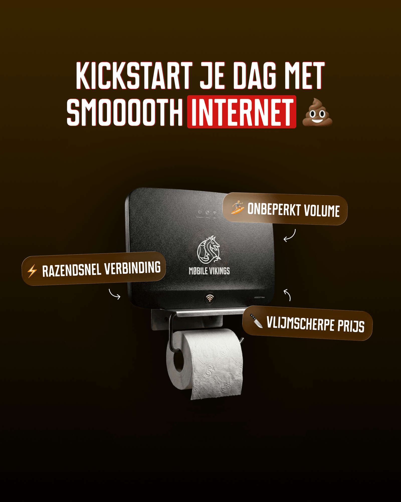
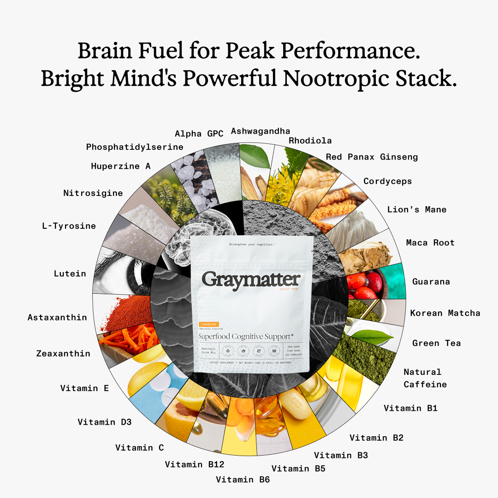
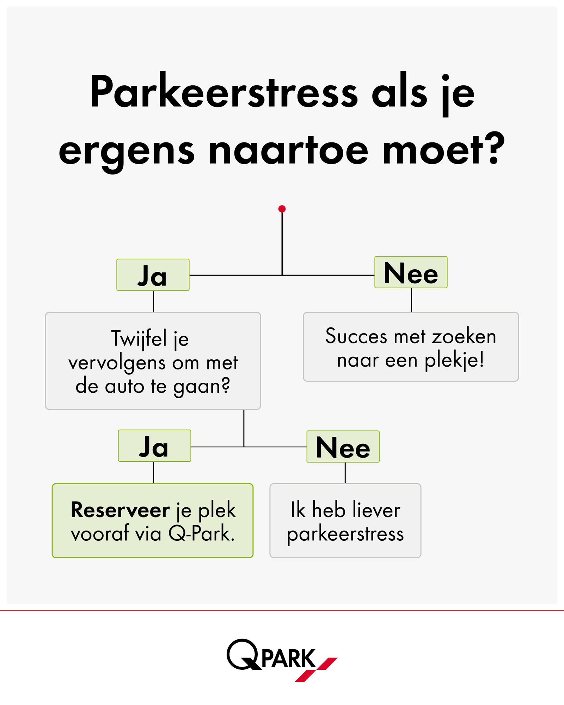
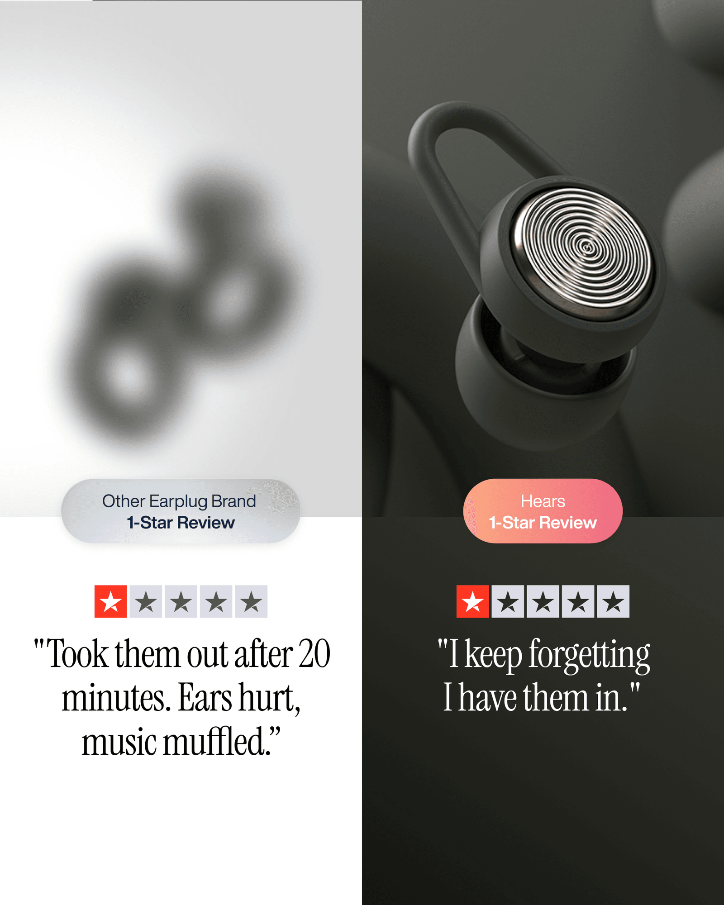
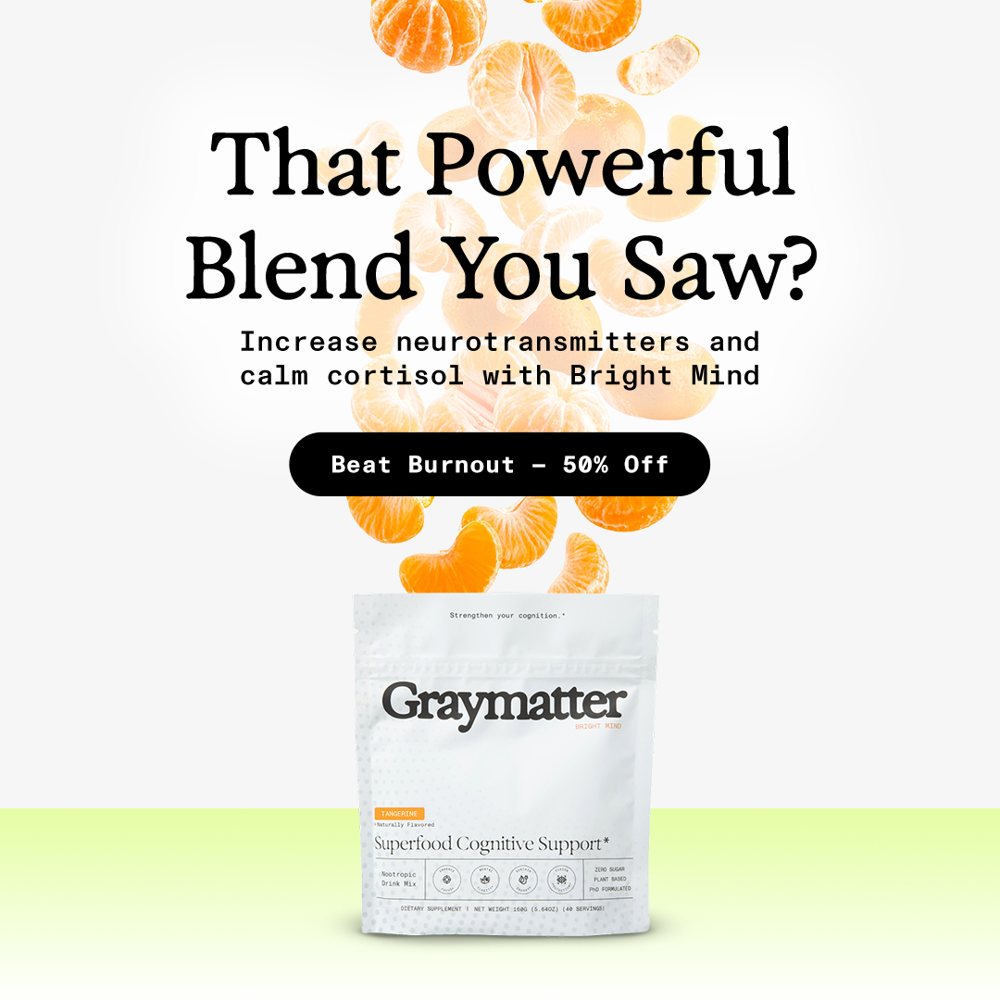

# Design Bible - Shresht

The working rules for how we design ads. Every entry is dated because styles expire. Updated daily, or whenever we talk design, whichever comes first. Started 21 November 2026.

## How this doc works

- Updated every day, or whenever we have a conversation about designs. Every new design decision lands here as a dated changelog entry. (Rule, 21 Nov 2026.)

- Every style and reference entry carries a date. An entry holds until a newer dated entry replaces it. (Rule, 21 Nov 2026.)

- Feedback is logged visually: the commented frame's screenshot plus the note, so the mistake is seen, not paraphrased. (Rule, 21 Nov 2026.)

- The changelog at the end is the running record. Newest decisions go on top.

## Standing workflow rules

- 21 Nov 2026. Before any design work starts, check three things: the brief, the existing designs, and the winning ads. Every time, before beginning.

- 21 Nov 2026. Every update about Figma work includes the specific Figma link it concerns. Updates about a specific frame include the frame link.

- 20 Nov 2026. MPS copy is verbatim. Hook, body, CTA and disclaimer go in exactly as written. If copy feels too long for the layout, flag it to Shresht and he checks with the concerned person. Never shorten or rewrite it ourselves.

- 20 Nov 2026. Batch anatomy: one Figma file per client ("Client x Rv"), one page or section per batch. Frame name = MPS Asset ID exactly, plus the ratio (9x16 or 1x1). Every concept ships as V1 and V2, each in both ratios.

- 20 Nov 2026. A design drop is reported only when the full requested set is done, not piecemeal.

- 20 Nov 2026. After anything ships, open it the way a viewer would and visually verify every image, every order, every text before calling it done.

- 22 Nov 2026. Feedback scope and editability: feedback given on one ad can apply to all ads in the batch; a change made on one ratio (e.g. 4:5) is mirrored on its resizes. Every ad ships fully editable: native text layers, native CTA shapes, separate photo and logo layers.

- 22 Nov 2026. Safe zones: the Meta safe-zone reference is the Figma Community file at figma.com/design/A3p5Z0WK0gIiv1u7bUSpwC. Place the safe-zone layer in the background of every frame while designing to check text placement; hide it when done but keep it in the layers so he can cross-check.

- 23 Nov 2026, 1:43am. Full editability is a hard rule (Shresht: "every ad board makes it. It should be editable"): every ad must be fully editable in Figma, with real text layers and separate logo, product and background layers. Nothing is flattened into an image.

## Rejected directions

Each entry shows what was made, his note, and the rule it leaves behind. These are do-not-repeat records, not drafts to revive.

### 1. "image stretched", 20 Nov 2026, 10:35pm

His Figma comments on both 1x1 frames: "image stretched" / "Image is stretched". Cause: replacement photos were uploaded into template layers that kept the old image's crop transform, so the photo strips rendered warped. Fixed the same night.

Rule it left: after replacing an image in a template layer, reset the fill and reframe the crop. Never trust an inherited transform. He flags distortion instantly.

The set those comments were on, shown after the fix. The original warped state was not separately archived.

*Visual reference retained in the internal Design Bible; not included in this public copy.*

### 2. Misses the moodboard language, 20 Nov 2026, 11:50pm

His note: the designs did not match any design language or style from the moodboards and reference links he had shared.

The gap analysis that followed, recorded so the same six failures do not recur:

- Template-default composition: a cream card with a photo strip, the template's own layout.

- Headlines too timid to be the biggest event on the ad.

- The honey italic accent missing on V1.

- Flat staged photos that read generated.

- No signature graphic device; nothing that makes the ad recognisably his.

- Stacked-up density: too many elements competing.

Rules it left: no cream-card-plus-photo-strip templates. Either a full-bleed photo with type in the quiet zone, or a confident solid ground with one staged element. The headline must be the biggest thing on the ad. One signature graphic device per ad. Elements should break frame boundaries for real depth.

### 3. The rebuilt direction, rejected entirely, 21 Nov 2026, 1:44am

What was made: a full rebuild in a new file. V1 in a full-bleed photography register; V2 on a solid sand ground with a cutout figure and a honey ring as the signature device. Both in 9x16 and 1x1.

His call: the rebuild does not land either. Design execution waits for Claude; Instinct-led designing stops here.

Rule it left: Instinct does not execute ad design. The workflow rules above still govern whoever designs next.

The four rebuilt frames as delivered for review, 21 Nov 2026. Rejected as a direction.

*Visual reference retained in the internal Design Bible; not included in this public copy.*

## Lucori brand facts

Read from the client's file, 20 Nov 2026. These are the brand's own constraints and hold independent of any rejected composition.

- Headline: Newsreader serif, with one honey-coloured italic accent word or line.

- Body: Inter.

- CTA: black pill.

- Ground: cream.

- The "Lucori" wordmark appears on every ad.

- Imagery: humans only, warm everyday lifestyle, real skin, premium-stock look. No AI slop.

- Disclaimer microcopy sits at the bottom edge, per the MPS, on medical assets.

## Tool stack

- 23 Nov 2026. Image generation routing. Roveir (RV agency) client jobs - a Roveir brief or MPS, or a Roveir client such as Alpha One Labs - use the Magnific connector once it is connected; until it is, ask Shresht first. His own work (brand, X, portfolio, KDP) generates with the Gemini API via GEMINI_API_KEY, and upscales only on a free Magnific account if it works. If it is unclear which route applies, ask before generating.

- 21 Nov 2026. Image generation runs on the Gemini API via Google AI Studio. Standard model roughly ₹4.30 per image including GST; Pro roughly ₹12.40. Pay per image, no commitment.

- 21 Nov 2026. Higgsfield skipped. $27/month billed yearly only beats the API past roughly 200 Pro images a month, and typography is set in Figma anyway. Revisit only if motion ads become a real ask.

- 21 Nov 2026. Magnific is the upscaler. Account verified ([account email omitted], Free plan).

- 20 Nov 2026. Figma is the design surface: one file per client, batch pages inside.

- Open question, raised 21 Nov 2026. The watermark Gemini leaves on generated images. Unresolved.

## Approved reference directions

Mood board round 1, 20 Nov 2026. All three approved, no rejections. Source: design4.ca/guides/supplement-ads. Visual references only; not performance-verified, not assets to copy.

- Ritual: tonal product photography. One brand hue, one architectural prop, hard directional light. Keep clean space for approved copy instead of overlaying it on the product.

- Seed: one-variable comparison. Split background, matched scale and position, exactly one comparison variable, readable before the copy.

- AG1: editorial offer grid. Cream ground, aligned kit components, calm object hierarchy, serif headline. Captions and conditions stay readable.

### Approved work and visual references

Added 21 Nov 2026. Open these links alongside the approved-direction notes above.

- Shipped static-ad work: Mango statics (Figma)

- Approved Lucorri work: Lucorri x Rv (Figma)

- [Ritual: supplement-ad examples (Design4Studio guide)](https://design4.ca/guides/supplement-ads)

- [Seed: supplement-ad examples (Design4Studio guide)](https://design4.ca/guides/supplement-ads)

- [AG1: supplement-ad examples (Design4Studio guide)](https://design4.ca/guides/supplement-ads)

## Other brand rules

- 20 Nov 2026. Research-use-only brands (peptides and similar): zero humans, hands included. Vials, plain backgrounds, biotech texture. The ad's job is to attract, look professional and build presence.

- 21 Nov 2026. Working principle: every client is different, so every ad is tailored to its client exclusively. A batch that reuses one template looks lazy and the client sees it. Before designing, research the client's existing style: open their Figma file (page 1 holds previous batches), study their brand colors, fonts, spacing and how much their past ads vary, then add reference research from comparable brands. Then design each ad with its own layout. Vary the background per ad: red, white, all-white, black or dark, whatever fits the client's palette. Give every ad its own layout device: text inside the image so it feels dynamic, a photo cropped smaller so there is space around it to play with type, a 3D touch or a shape behind the product with text set on the shape. Composition experiments are expected, not optional. Before delivery, line the batch up side by side. If two ads look alike, redo one. Why this exists: surfaced on Alpha One Labs batch 2, where V1 and V2 used one template (white panel on the left, text on it) and Shresht said every ad looked almost the same. Alpha One Labs is the example, the rule applies to every client.

- 21 Nov 2026. Type on red: headings on a red background go all white - black does not read well on red. Flat red shapes need texture or pattern, never a bare flat fill.

- 21 Nov 2026. Alpha One Labs batch 2 review anchors: he liked the black-background ad with the red 3D sphere behind the vial, and the full-red ad with the text inside the image. He rejected the off-white centered statement layout and the plain white / lab-photo layouts as too basic. Use these as direction anchors for batch 2 work.

- 21 Nov 2026. Alpha One Labs (client file: Alpha 1 labs in Figma, page 1 holds batch 1): brand colors are red, black and white; headline in heavy uppercase sans with a red key phrase; serif body; black CTA with an arrow; the real wolf and DNA logo. Vials on research-use-only brands carry plain blank white labels, never branded or with added text. Match batch 1 colors, fonts and spacing, a bit more minimal. No humans, hands included.

## 21 Nov 2026, 3:42am. Mesh gradient (soft blurred multi-color blobs: coral, lavender, pale pink, brand orange, per the avatar style he approved) is a standing brand signature for Shresht's own brand. Integrate it into every design we make for him: X post mockups, templates, everything.

## 21 Nov 2026, from Shresht. Copy rule for videos and ads: no pronouns anywhere in video scripts or ad copy - never "we", "us", "he", "him", "they", "them", or "I". CTA style is bare imperative, e.g. "Need designs? DM or email."

## Layout design rules

23 Nov 2026. Added after Shresht's review of Claude's Alpha One Labs ad ("The little things add up"): layout not balanced, logo placement poor, and layout design needs much deeper learning. Layout is its own discipline, so it gets its own section with checkable rules. Layout-only ad examples with sources close the section.

### Grid

- 23 Nov 2026. Every frame sits on a grid: fixed outer margins (about 8-10% of frame width) and a simple column grid. Text blocks, product and logo snap to it. Nothing is placed by eye alone.
- 23 Nov 2026. Elements share edges. Any two blocks that start or end near each other align to exactly the same edge or baseline; near-misses read as mistakes, not looseness.

### Balance and visual weight

- 23 Nov 2026. Weight comes from size, contrast and color density: a dark or busy element weighs more than a light one the same size.
- 23 Nov 2026. Every heavy element needs a counterweight on the opposite side of the frame. A heavy element on the right (chart, product) is balanced by weight on the left or bottom, never by stacking more elements on the same side. (What failed in the reviewed ad: chart on the right and logo top right put all the weight on one side.)
- 23 Nov 2026. Balance is not symmetry. Asymmetric layouts are fine when the weights match. Check: flip the frame horizontally; if the flipped version feels like it tips over, the original was unbalanced.
- 23 Nov 2026. Squint test: blur the eyes and read the frame as 2-3 weight masses. If one corner pulls everything, redistribute before shipping.

### Logo placement

- 23 Nov 2026. The logo is a quiet element, never the focal point. It sits in a corner or anchored to the bottom row, at the grid margin, legible but never competing with the headline.
- 23 Nov 2026. One logo, placed once. It is never the biggest element on the ad.
- 23 Nov 2026. The logo counter-balances the layout: it goes on the light side of the frame, not piled onto the heavy side.
- 23 Nov 2026. The logo sits on clean ground with clear space around it, at least half its own height on all sides, and never over a busy part of the image.

### Text block alignment

- 23 Nov 2026. One alignment axis per text group: heading, subline, body and CTA share one left edge, or the whole group is centered. Never a left-aligned heading over a centered subline.
- 23 Nov 2026. Centered text only when the entire composition is centered. If anything else on the frame is left-anchored, the text is left-anchored too.

### Whitespace

- 23 Nov 2026. Whitespace is a design element, not leftover space. The empty areas are decided as deliberately as the filled ones.
- 23 Nov 2026. Margins and gaps come from a small spacing scale (multiples of one base unit), the same scale across every ad in a batch.
- 23 Nov 2026. Grouping rule: gaps inside a group of related elements are smaller than gaps between groups, so related things read as one unit.
- 23 Nov 2026. Text coverage stays low: as a working ceiling, keep text under about a fifth of the ad area so the layout breathes (Google's display guidance uses a 20% text ceiling).

### Line breaks in headings and sublines

- 23 Nov 2026, from Shresht. Heading and subline line breaks must be uniform: never 3 or 4 words on the upper lines with a single orphan word on the last line.
- 23 Nov 2026. Break lines at meaning boundaries, where a phrase naturally ends, and keep line lengths even. If one line has to be shorter, it is the first line, never the last.
- 23 Nov 2026. Before accepting an orphan word, fix it: rebalance the break, adjust the container width, or resize the type. An orphan word is a defect, not a style.
- 23 Nov 2026. Re-check breaks on every resize. A break that is balanced in 1:1 can orphan in 9:16; re-break per ratio.

### Hierarchy

- 23 Nov 2026. One dominant element per frame, clearly the biggest: the headline or the visual, not both fighting. If two elements compete for first place, one of them shrinks.
- 23 Nov 2026. The scan order is designed, not accidental: headline first, then the visual, then the subline, then the CTA and logo. Check with a 2-second flash test: show the frame briefly and confirm what was read first.

### Agency layout study: Subyect + Roveir/Roveia Health (research, 23 Nov 2026)

Studied about 90 ads across Subyect's public work (subyect.com ad wall and project sections) and Roveir's case studies (roveir.com/case-studies and roveia.com, the Roveir health arm): Blocout, Hears, Eclat, Mobile Vikings, Q-Park, Amacx, Samako and Son of John on Subyect; Graymatter, Wellvia, Verve, TrimRx, Odin, Neobanc, Traction K9 and Metatailor on Roveir. 23 Nov 2026, on Shresht's ask to understand layout. Revised the same day after the full pass across every case study: the TrimRx-style pharma layouts (coupon ticket, heavy serif price card) are the weak end of the set, and no rule below rests on them.

- 23 Nov 2026. One structural idea per ad: the strongest ads commit to a single layout device (a wheel, a flowchart, a mirrored split, a panel) instead of the generic headline-photo-CTA stack. The weak ads in the set all share that default: top headline, middle photo, bottom pill.

- 23 Nov 2026. Center axis with orbiting proof: product dead center; label pills, ingredients or stats float around it on implied rails or a circle (Subyect Mobile Vikings: floating label pills on rails around the phone; Roveir Graymatter: radial ingredient wheel, wedges around the bottle with monospace labels on the circle). The orbit turns specs into composition.

  

  

- 23 Nov 2026. A diagram can be the whole layout: Subyect Q-Park runs a decision flowchart down the frame and the green outcome box doubles as the CTA; Roveia Verve's weight-loss ad is a three-step vertical timeline with numbered cards alternating sides. The process itself becomes the layout.

  

- 23 Nov 2026. Mirrored splits sell contrast: split the canvas and repeat the same module on each side - blurred competitor vs sharp product (Subyect Hears: label pill, star row and quote on each half), or old-me struck through vs new-me (Roveia Verve). Symmetry makes the comparison readable at a glance.

  

- 23 Nov 2026. Panel vs photo split, roughly 40/60: a flat-color text panel against a full-height lifestyle photo (Subyect Amacx: navy panel with headline, chips and CTA against the athlete shot). The panel informs, the photo feels.

  

- 23 Nov 2026. Strikethrough marks the old: old price or old state struck through beside the new (Roveia Wellvia: $259 struck to $129.99; Roveia Verve: symptoms struck under old-me). The strike carries the comparison; no extra copy needed.

- 23 Nov 2026. UI mimicry as layout: fake chat bubbles, comment sheets, iOS toggles, review cards and real screenshots (Google Maps route on Roveir Traction, export dialog on Roveir Metatailor) carry the copy, and the UI's own grid becomes the layout grid (Subyect Hears and Blocout).

- 23 Nov 2026. One headline device per ad: a marker highlight, a color swap or one italic serif accent word, never all three at once (Subyect throughout).

- 23 Nov 2026. Serif carries emotion, sans carries information: display serif or condensed uppercase for the headline, small sans for specs and labels (Roveir Graymatter mixes an italic serif word into a sans stack).

- 23 Nov 2026. Benefits go in pill chips, 2-3 max, in one row or a loose stack, never as a typed bullet list (Subyect Hears chips and Blocout toggles).

- 23 Nov 2026. Corner framing: product cropped at opposite corners or propped at frame edges, leaving the center for the text stack (Roveia Verve vials at the corners).

- 23 Nov 2026. Echo typography for depth: the headline repeated as outlines behind the product, with the product breaking the type plane (Subyect Blocout).

- 23 Nov 2026. One accent color, spent at most twice: the CTA pill and one headline word or an offer bar. Everything else stays in brand neutrals (Roveir Graymatter green; Roveir Neobanc pink on blue).

- 23 Nov 2026. The product gets a stage: a pedestal, soft shadow, glow or ground plane, never floating raw on the background (Subyect Hears pedestal; Roveir Graymatter v9, where the ingredient cascade sits behind the headline and the product stands on a baseline).

  

- 23 Nov 2026. Crop a repeatable module off-canvas: Roveir Odin bleeds a grid of integration logo cards off the bottom edge, implying an endless list; a partial grid reads bigger than a complete one.

  

- 23 Nov 2026. Let one prop carry the concept: Roveia Wellvia's crossed-out syringe on foliage with a short headline and no feature list. A symbolic object plus a few words beats a spec sheet.

  

Strongest reference frames from this pass: Subyect Mobile Vikings (pills on rails), Q-Park (flowchart), Hears w20 (mirrored split), Amacx (panel split); Roveir Graymatter (radial wheel and the v9 center-stage), Odin (off-canvas grid); Roveia Wellvia (conceptual prop). The best eight went to Shresht as images and are committed under references/, each linked above next to its matching rule.

### Layout-only ads that work (research, 23 Nov 2026)

Ads that carry the whole message through layout and type alone, with why they work:

- McDonald's "Iconic Stacks" (Leo Burnett London, 2020): billboards showing only a centered stack of ingredient words in Helvetica, no logo, no product photo. It works because the uniform word stack and the brand colors do all the work; reading the stack reveals the product. Lesson: a disciplined, evenly set text stack on a brand-colored ground can carry an ad by itself. Source: marketingdive.com/news/campaign-trail-mcdonalds-brandless-ad-marketing/572696/
- Nike "Just Don't Quit": the top two-thirds of the ad is one bold sans-serif message; filled and outlined letters hide "Just Do It" inside it, and the swoosh sits small at the bottom. Lesson: one type mass owns the frame while the logo whispers from the corner. Source: clutch.co/resources/typographic-ad
- Apple "Think Different": bold sans-serif on a plain ground, where letter spacing, weight and alignment alone create the rhythm and the hierarchy. Lesson: when type is the only element, spacing decisions are the design. Source: clutch.co/resources/typographic-ad
- Pepsi "Joy": bold white sans-serif on brand blue, the letter O replaced by the globe logo, perfectly centered. Lesson: the logo can live inside the type when the spacing stays even and the placement is exact. Source: clutch.co/resources/typographic-ad
- Got Milk?: one short line in a heavy, iconic sans on an all-white ground, readable in a glance. Lesson: a single short message, set huge and centered, needs nothing else. Source: clutch.co/resources/typographic-ad
- More typography-led references: themuseumofads.com/technique/typography-led

## Changelog

- 23 Nov 2026, 1:50am. Agency layout study revised after a broader pass over about 90 ads across all Subyect projects and every Roveir/Roveia case study: TrimRx-based examples dropped (Shresht disliked the TrimRx ad), and new layout devices added (flowchart-as-layout, radial wheel, mirrored split, panel split, timeline, off-canvas grid crop, screenshot hero, conceptual prop). The 8 strongest frames are committed as images under references/ and linked from the study (Shresht, 23 Nov 2026 1:52am: "Add these in the design bible for visual reference. These are really good").

- 23 Nov 2026. Hard rule from Shresht: every ad must be fully editable in Figma (real text layers; separate logo, product and background layers; nothing flattened to an image). His words: "every ad board makes it. It should be editable".

- 23 Nov 2026. Agency layout study added under Layout design rules: recurring layout moves from Subyect's ad wall and Roveia Health case studies. (Entry: Agency layout study.)

- 23 Nov 2026. Layout design rules section added after his review of Claude's Alpha One Labs ad (layout not balanced, logo placement poor): grid, balance and visual weight, logo placement, text block alignment, whitespace, uniform heading and subline line breaks with no orphan words, and hierarchy, plus layout-only ad examples with why they work.

- 23 Nov 2026. Image generation routing logged: Roveir client jobs use the Magnific connector once connected (ask Shresht first until then); his own work generates via the Gemini API (GEMINI_API_KEY) and upscales on a free Magnific account if it works; ask before generating when the route is unclear.

- 22 Nov 2026. Synced from the Design Bible doc: type-on-red and flat-red texture rule, Alpha One batch 2 review anchors, feedback-scope / mirror-across-ratios / full-editability rule, and the Meta safe-zone workflow.

- 21 Nov 2026. Working principle logged: tailor every ad to its client exclusively. Research the client's existing style first, then vary background and layout ad to ad, never one template per batch. Surfaced on Alpha One Labs batch 2 (V1 and V2 looked almost the same: white panel left, text on it). Client reference confirmed from the Alpha 1 labs Figma file: red, black and white, heavy uppercase sans headline with red key phrase, serif body, black CTA with arrow, plain white unbranded vial labels.

- 21 Nov 2026. Video and ad copy rule: no pronouns anywhere in scripts or ad copy (never we, us, he, him, they, them, or I); CTAs are bare imperatives, e.g. "Need designs? DM or email."

- 21 Nov 2026. Mesh gradient (multi-color soft blobs) is a standing brand signature - integrate into all designs, per his 3:42am direction.

- 21 Nov 2026. Portfolio website refinements: ad wall repositioned edge to edge; background grid lines removed; opacity changed to a per-tile fade outward from the center after the banded overlay was rejected; nav made sticky; mobile hero chips returned to floating around the portrait.

- 21 Nov 2026. Approved visual references linked for Mango static ads, approved Lucorri work, and Ritual / Seed / AG1 directions.

- 21 Nov 2026. Design Bible published to Drive. Standing rule set: update daily or on every design conversation, whichever comes first.

- 21 Nov 2026. Rebuilt direction rejected; Instinct design execution paused. (Rejected directions, entry 3.)

- 20 Nov 2026. First set rejected on design language; gap analysis recorded. (Entry 2.)

- 20 Nov 2026. "image stretched" comments on both 1x1 frames; fixed same night; logged. (Entry 1.)

- 20 Nov 2026. Mood board round 1 approved: Ritual, Seed, AG1.

- 20 Nov 2026. Workflow rules recorded: MPS verbatim, batch anatomy, full-set delivery, visual verification after shipping.
