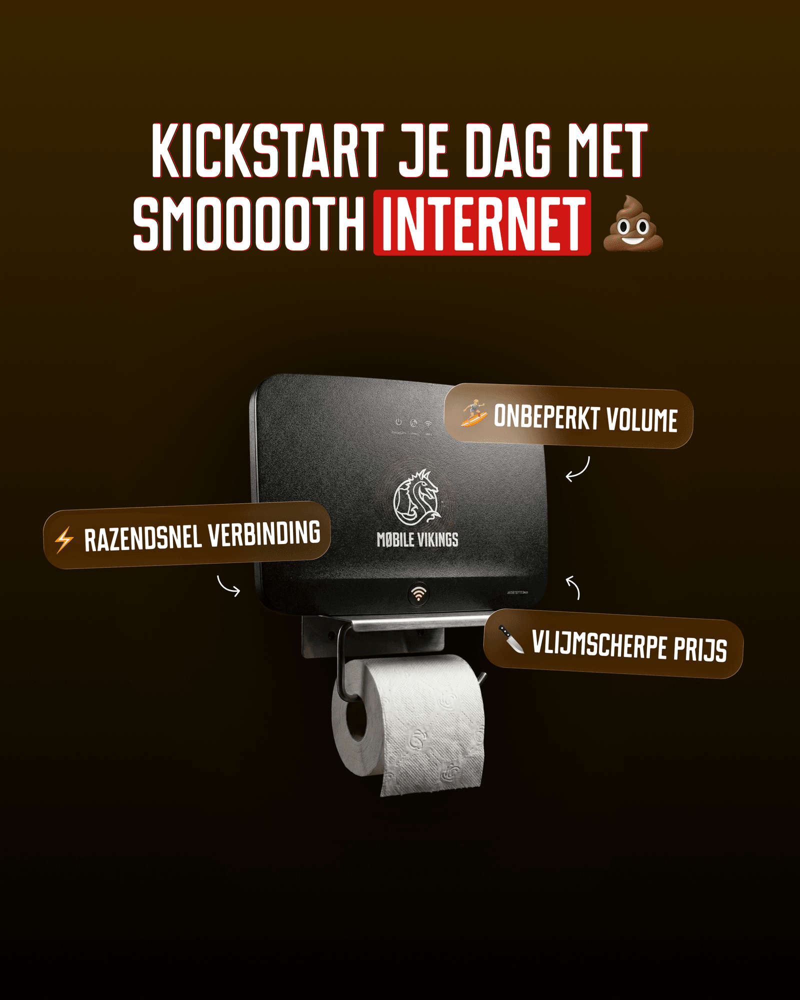
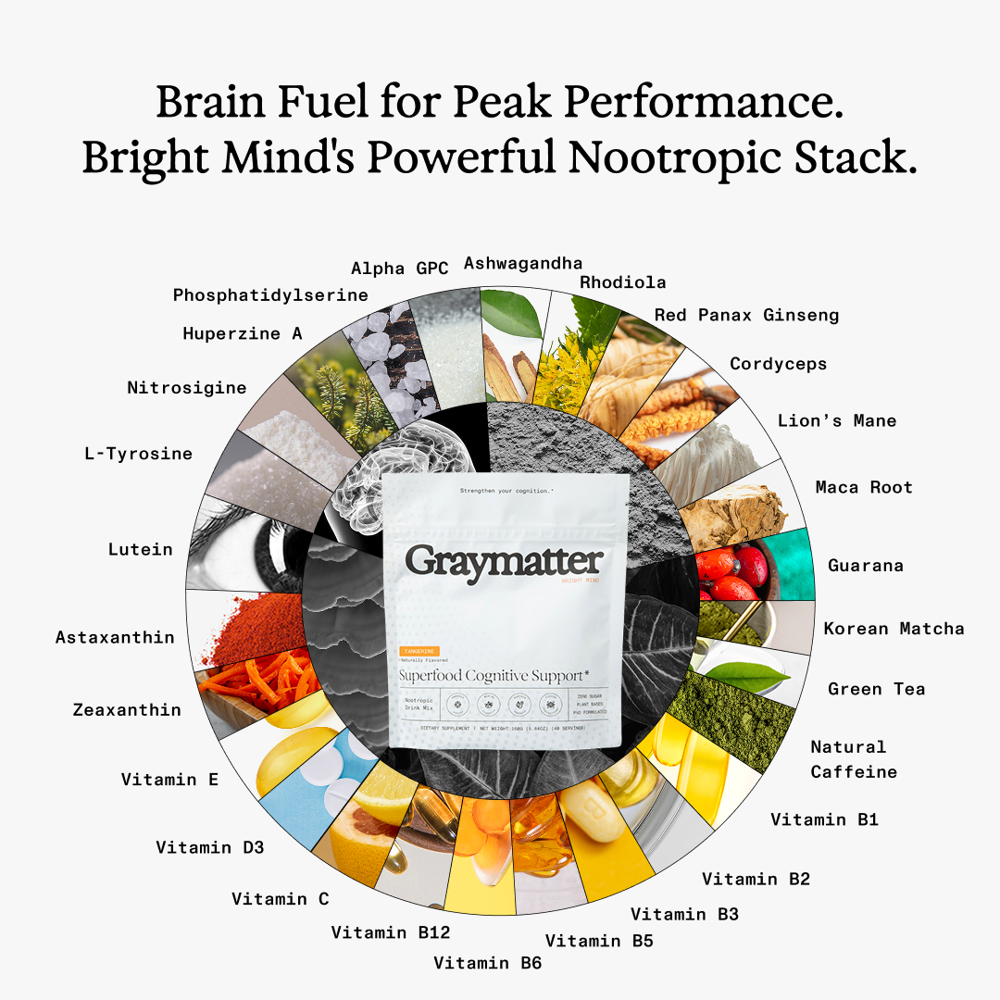
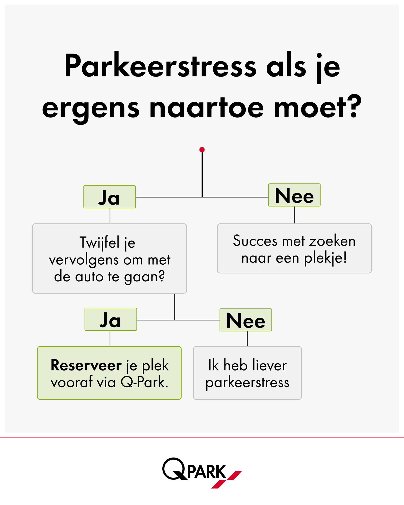
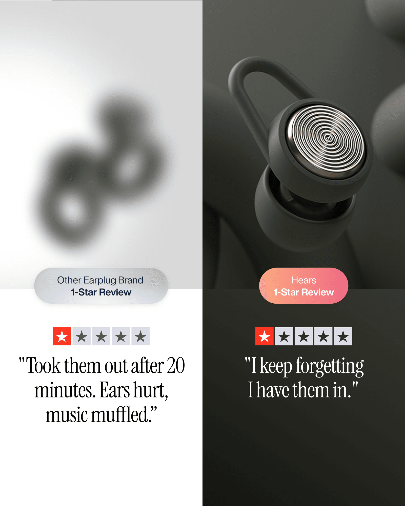
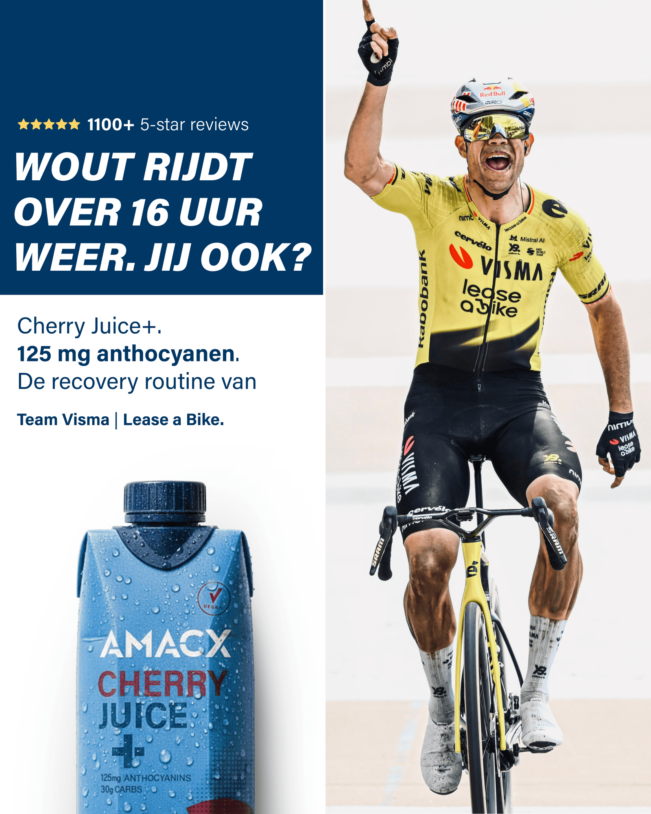
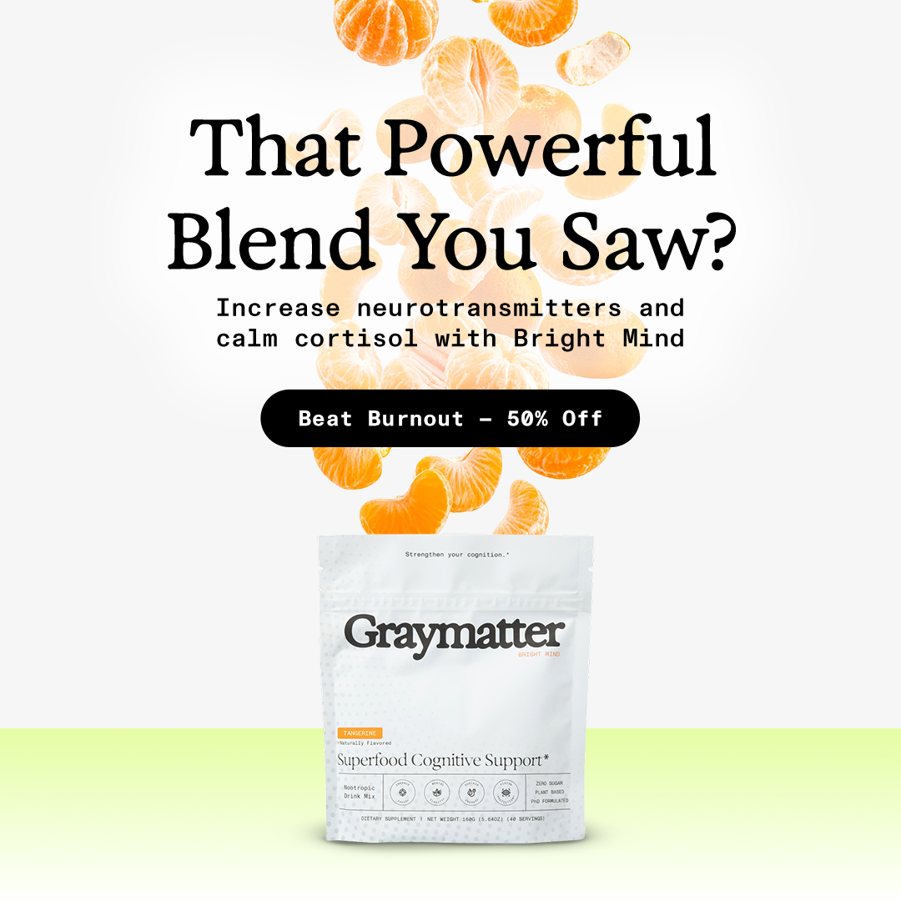
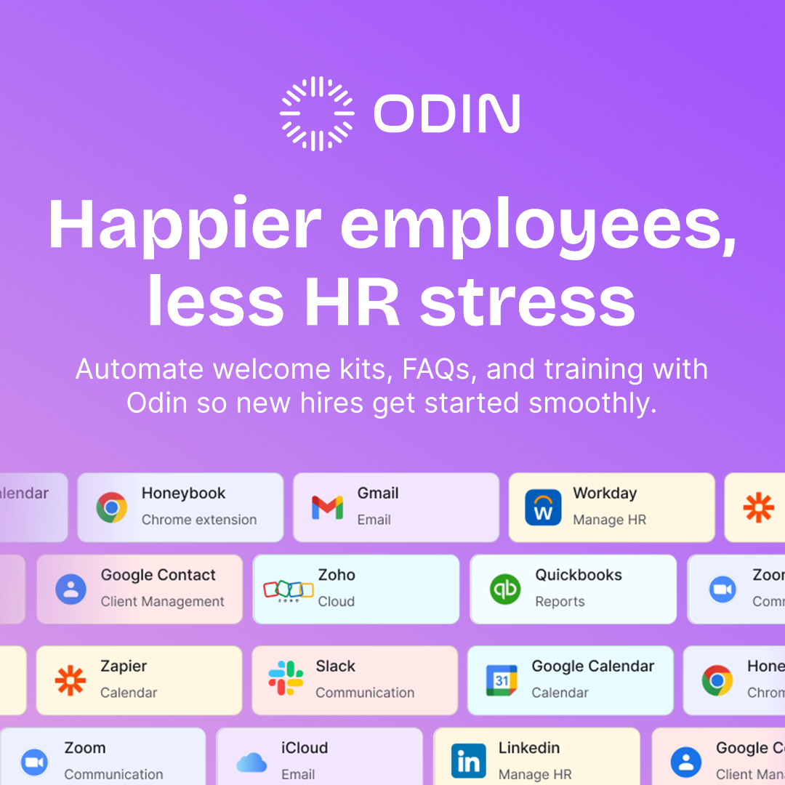
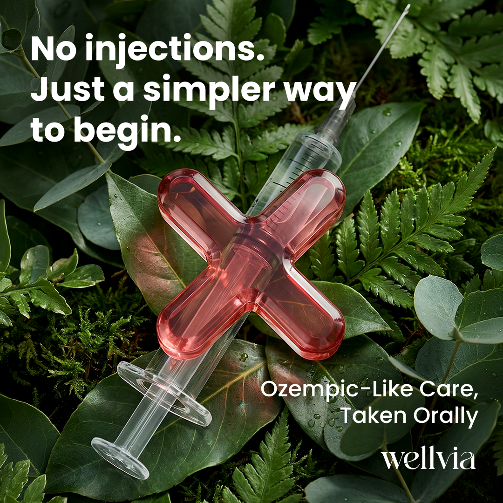

# Layout studies

Research behind the layout rules in design-bible.md. Use it when concepting: it explains why the rules exist and gives devices to pick from. Visual references only, never assets to copy. Where a study conflicts with a live rule, the live rule wins (notes in brackets mark the known conflicts). Moved from design-bible.md on 25 Nov 2026.

## Agency layout study: Subyect + Roveir/Roveia Health (research, 23 Nov 2026)

Studied about 90 ads across Subyect's public work (subyect.com ad wall and project sections) and Roveir's case studies (roveir.com/case-studies and roveia.com, the Roveir health arm): Blocout, Hears, Eclat, Mobile Vikings, Q-Park, Amacx, Samako and Son of John on Subyect; Graymatter, Wellvia, Verve, TrimRx, Odin, Neobanc, Traction K9 and Metatailor on Roveir. 23 Nov 2026, on Shresht's ask to understand layout. Revised the same day after the full pass across every case study: the TrimRx-style pharma layouts (coupon ticket, heavy serif price card) are the weak end of the set, and no rule below rests on them.

- 23 Nov 2026. One structural idea per ad: the strongest ads commit to a single layout device (a wheel, a flowchart, a mirrored split, a panel) instead of the generic headline-photo-CTA stack. The weak ads in the set all share that default: top headline, middle photo, bottom pill.

- 23 Nov 2026. Center axis with orbiting proof: product dead center; label pills, ingredients or stats float around it on implied rails or a circle (Subyect Mobile Vikings: floating label pills on rails around the phone; Roveir Graymatter: radial ingredient wheel, wedges around the bottle with monospace labels on the circle). The orbit turns specs into composition.

  

  

- 23 Nov 2026. A diagram can be the whole layout: Subyect Q-Park runs a decision flowchart down the frame and the green outcome box doubles as the CTA; Roveia Verve's weight-loss ad is a three-step vertical timeline with numbered cards alternating sides. The process itself becomes the layout.

  

- 23 Nov 2026. Mirrored splits sell contrast: split the canvas and repeat the same module on each side - blurred competitor vs sharp product (Subyect Hears: label pill, star row and quote on each half), or old-me struck through vs new-me (Roveia Verve). Symmetry makes the comparison readable at a glance.

  

- 23 Nov 2026. Panel vs photo split, roughly 40/60: a flat-color text panel against a full-height lifestyle photo (Subyect Amacx: navy panel with headline, chips and CTA against the athlete shot). The panel informs, the photo feels.

  

- 23 Nov 2026. Strikethrough marks the old: old price or old state struck through beside the new (Roveia Wellvia: $259 struck to $129.99; Roveia Verve: symptoms struck under old-me). The strike carries the comparison; no extra copy needed.

- 23 Nov 2026. UI mimicry as layout: fake chat bubbles, comment sheets, iOS toggles, review cards and real screenshots (Google Maps route on Roveir Traction, export dialog on Roveir Metatailor) carry the copy, and the UI's own grid becomes the layout grid (Subyect Hears and Blocout).

- 23 Nov 2026. One headline device per ad: a marker highlight, a color swap or one italic serif accent word, never all three at once (Subyect throughout). [Live rule L-24: never an italic serif accent inside a headline; L-25: one device, colour or weight.]

- 23 Nov 2026. Serif carries emotion, sans carries information: display serif or condensed uppercase for the headline, small sans for specs and labels (Roveir Graymatter mixes an italic serif word into a sans stack). [Live rule L-24: one family per headline; a serif accent inside a sans headline flags as machine-made.]

- 23 Nov 2026. Benefits go in pill chips, 2-3 max, in one row or a loose stack, never as a typed bullet list (Subyect Hears chips and Blocout toggles).

- 23 Nov 2026. Corner framing: product cropped at opposite corners or propped at frame edges, leaving the center for the text stack (Roveia Verve vials at the corners).

- 23 Nov 2026. Echo typography for depth: the headline repeated as outlines behind the product, with the product breaking the type plane (Subyect Blocout).

- 23 Nov 2026. One accent color, spent at most twice: the CTA pill and one headline word or an offer bar. Everything else stays in brand neutrals (Roveir Graymatter green; Roveir Neobanc pink on blue).

- 23 Nov 2026. The product gets a stage: a pedestal, soft shadow, glow or ground plane, never floating raw on the background (Subyect Hears pedestal; Roveir Graymatter v9, where the ingredient cascade sits behind the headline and the product stands on a baseline).

  

- 23 Nov 2026. Crop a repeatable module off-canvas: Roveir Odin bleeds a grid of integration logo cards off the bottom edge, implying an endless list; a partial grid reads bigger than a complete one.

  

- 23 Nov 2026. Let one prop carry the concept: Roveia Wellvia's crossed-out syringe on foliage with a short headline and no feature list. A symbolic object plus a few words beats a spec sheet.

  

Strongest reference frames from this pass: Subyect Mobile Vikings (pills on rails), Q-Park (flowchart), Hears w20 (mirrored split), Amacx (panel split); Roveir Graymatter (radial wheel and the v9 center-stage), Odin (off-canvas grid); Roveia Wellvia (conceptual prop). The best eight went to Shresht as images and are committed under references/, each linked above next to its matching rule.

## Layout-only ads that work (research, 23 Nov 2026)

Ads that carry the whole message through layout and type alone, with why they work:

- McDonald's "Iconic Stacks" (Leo Burnett London, 2020): billboards showing only a centered stack of ingredient words in Helvetica, no logo, no product photo. It works because the uniform word stack and the brand colors do all the work; reading the stack reveals the product. Lesson: a disciplined, evenly set text stack on a brand-colored ground can carry an ad by itself. Source: marketingdive.com/news/campaign-trail-mcdonalds-brandless-ad-marketing/572696/
- Nike "Just Don't Quit": the top two-thirds of the ad is one bold sans-serif message; filled and outlined letters hide "Just Do It" inside it, and the swoosh sits small at the bottom. Lesson: one type mass owns the frame while the logo whispers from the corner. Source: clutch.co/resources/typographic-ad
- Apple "Think Different": bold sans-serif on a plain ground, where letter spacing, weight and alignment alone create the rhythm and the hierarchy. Lesson: when type is the only element, spacing decisions are the design. Source: clutch.co/resources/typographic-ad
- Pepsi "Joy": bold white sans-serif on brand blue, the letter O replaced by the globe logo, perfectly centered. Lesson: the logo can live inside the type when the spacing stays even and the placement is exact. Source: clutch.co/resources/typographic-ad
- Got Milk?: one short line in a heavy, iconic sans on an all-white ground, readable in a glance. Lesson: a single short message, set huge and centered, needs nothing else. Source: clutch.co/resources/typographic-ad
- More typography-led references: themuseumofads.com/technique/typography-led

## Carousel study: @joshuaseage TV home-screen launch (research, 23 Nov 2026)

Studied a 5-slide Instagram carousel by @joshuaseage (15 Nov 2026, about 12k likes and 9.5k comments in a week; public post: instagram.com/p/DfvtVeklL3J/) promoting a free, open-source, Claude-built TV home screen. Reference for series and carousel-format statics and for Shresht's own content.

- 23 Nov 2026. One idea per slide, in plain spoken language: each slide carries a single claim and the caption repeats the same story. The slides and the caption never say two different things.
- 23 Nov 2026. White headline on black ground: a huge, tight white sans headline top-left on a black background, with exactly one screenshot or UI mock per frame (Apple-keynote register).
- 23 Nov 2026. Before/after is the proof: cluttered before against clean after, with a red annotation box drawn on the exact spot the viewer should look at. The annotation does the directing, not the copy.
- 23 Nov 2026. Keyword-comment CTA: "Comment COUCH and I'll send you the link" turns intent into comments the algorithm rewards (about 9.5k on this post). Use on his own content for distribution.
- 23 Nov 2026. Remove every objection on the CTA slide: "free and open source" plus reversible ("undo takes about 10 seconds") answers cost and risk before they are raised, with supported platforms listed.

## Statiq site review (Simon Robert's agency, statiq.club, 24 Nov 2026)

Reviewed on Shresht's ask, 24 Nov 2026: home, portfolio, the Hollow Socks and Oar Health case studies, and three of Simon Robert's posts. Spend figures there are Statiq's own claims. Visual references only, never assets to copy. Full notes: desk/statiq-site-lessons.md.

- 24 Nov 2026. Brief before design: every concept gets five answers before any image prompt, in this order: the person, what they really want (usually a feeling), how aware they are, the belief that has to shift, and only then the angle. Write them above each concept in the batch notes. Weak briefs jump straight to the angle.
- 24 Nov 2026. Vary one answer across a batch: concepts change one of the five answers (the persona, say) and keep the others, so a winner teaches something. Visuals and layouts still differ ad to ad (creative diversity rule under Meta platform facts). Fonts, badges and CTAs get tuned later, on the winner.
- 24 Nov 2026. Type size sets the order of the argument: the biggest line carries the pain or the surprising fact, the next carries the question or turn, and the shortest line lands last (Hollow: small kicker, huge condensed middle line, small closer). This takes the designed scan order under Hierarchy down to the lines inside the headline block.
- 24 Nov 2026. Product inside the headline: the product can sit in the type as the gap between two words or cut across a line (an Oar pill between "TOO" and "MUCH?", an Oar bottle through the headline, a Jiyu jar over one word). Every word must still pass the thumbnail test. For Alpha One the empty vial can take this role; sharing an edge with the headline (ad 01 rule) is the quieter version.
- 24 Nov 2026. One split, one contrast: one product straddling two worlds (Hollow's sock across a desert/snow split) or one object split down the middle (HexClad pan against plain stainless) carries a comparison without a second image. Claims on each side stay inside the client's claims register.
- 24 Nov 2026. Build a scene that says the line: make the headline literal in the set (Hollow's sock behind glass in a snowy emergency box). Generated scenes make this cheap; image routing, budget and vial rules still apply.
- 24 Nov 2026. Premium products: name the price objection in the headline, then answer it (Manukora asks if the honey is worth it, with the old price struck through and a review count; Lucky Fours quotes the objection in serif and answers with spec and price). Pairs with the strikethrough rule. Prices and counts come only from the brief.
- 24 Nov 2026. Italic as the emphasis device on dark grounds: Oar sets an all-white serif headline with one italic phrase. Where the red key phrase is off (headlines on dark go all white), one italic phrase can carry the emphasis. Still one headline device per ad. For Alpha One, suggest it before using it, since batch 1 sets a heavy uppercase sans headline. Replaced by 25 Nov 2026 (one family per headline, under Hierarchy): never put a serif italic inside a headline; use weight contrast instead.
- 24 Nov 2026. Proof sits small and low: a stat line or review strip along the bottom edge (Oar, Fussy), lighter than the CTA and never competing with the headline.
- 24 Nov 2026. Callouts with arrows are the category cliche for hooks: Hollow's earlier agencies stalled on "four value props with arrows". Statiq keeps callout layouts for offer and story ads. Don't make a callout layout the hook of a batch.
- 24 Nov 2026. Native can mean a designed copy of a non-ad format: Statiq's native winners imitate an iOS email notification (Carmoola), a LinkedIn post, a store listing (Manukora) or a handwritten note over a product shot (Stasis), all crafted. This is a different option from the unpolished photo look he rejected on 21 Nov. It still needs his yes; his answer is pending through Instinct (C-1123-14).
- 24 Nov 2026. The offer ad closes; it doesn't open: a plain listing-style offer ad can be an account's top spender (Manukora) because the top-of-funnel ads made the case first. In a batch the offer-led direction is the closer, and a batch is never all offer ads.
- 24 Nov 2026. Read a library by its gaps: map a brand's top 10 ads (client account or competitor Ad Library) against the five answers. The answers nobody is using are the next concepts. Job B can apply this to the weekly winning-ad finds.
